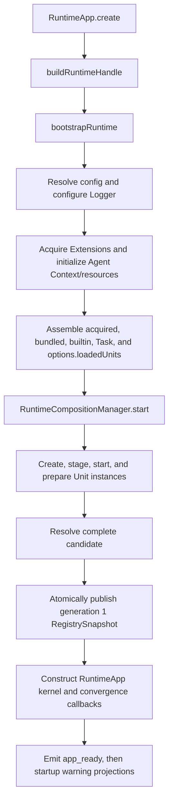
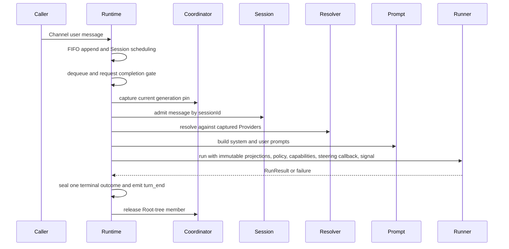

# Runtime

> Status: Current Authority
> Authority: Current implemented Runtime behavior
> Verified: 2026-11-18
> Ownership: Runtime composition, publication, generations, Turn orchestration, queues, routing, Fanout, Abort, Shutdown, and Subagent Parent/Child lifecycle
> Ownership key: runtime-composition-and-lifecycle

---

## 1. Purpose and ownership

`src/runtime/` is the application and Composition layer. It turns independently implemented Core, Platform, Builtin, and External Extension components into a running Agent.

Runtime owns:

- bootstrap coordination and narrow configuration projection;
- SettingsManager admission, saved editing views/revisions, serialized section
  updates and bounded pre-publication file rollback through Platform Configuration;
- the loaded Runtime Unit catalog and Unit-instance lifecycle;
- Registry candidate staging, validation, immutable Snapshot publication, generation capture, retirement, and reload admission;
- per-session Turn admission and queueing;
- origin routing, Agent-event Fanout, interactions, Abort, and bounded Shutdown;
- tracked Subagent Parent/Child membership and inherited generation/route lifecycle;
- process-global Tool execution slot/quarantine state and managed-process Session/shutdown cleanup.

Runtime delegates the internal Turn algorithm to [Runner](runner.md). Runner owns model calls, Tool/Hook admission, context budgeting, Compaction, and the point at which steering messages are consumed; the Async Tool Execution Framework owns implementation Promises. Runtime supplies an already resolved model, immutable generation projections, prompts, policy, approval capability, a wakeable steering source, and Abort signal; it does not execute Tools.

Runtime also does not discover or load Extension files. [Extensions](extensions.md) owns install-root discovery, validated scoped configuration, controlled entry loading, and production of not-yet-created `LoadedRuntimeUnit` values. Runtime owns every later create, start, registration staging, publication, retirement, and stop transition.

## 2. Current source layout

```text
src/runtime/
├── RuntimeApp.ts
├── config.ts
├── composition/
│   ├── runtime-builder.ts
│   ├── bootstrap.ts
│   ├── agent-home-lock.ts
│   ├── channel-lifecycle.ts
│   ├── composition-coordinator.ts
│   ├── registry-builder.ts
│   ├── reload-coordinator.ts
│   ├── runtime-composition-manager.ts
│   ├── runtime-composition.ts
│   ├── runtime-lifecycle.ts
│   └── runtime-unit.ts
├── settings/
│   ├── settings-manager.ts
│   ├── model-test.ts
│   ├── section-views.ts
│   ├── helpers.ts
│   └── index.ts
├── policy/
│   ├── agent-policy-state.ts
│   ├── tool-approval-policy.ts
│   └── glob-match.ts
├── runtime-deadline.ts
├── scheduling/
│   ├── session-message-scheduler.ts
│   ├── queue-types.ts
│   └── request-completion-gate.ts
├── subagent-orchestration.ts
├── prompt-factory.ts
├── turn-interaction/
│   └── TurnInteractionManager.ts
└── types.ts

src/builtins/
├── providers/builtin/runtime-unit.ts
├── channels/{cli,websocket}/runtime-unit.ts
└── tools/{environment,memory,task}/contribution.ts
```

The converged integration layout keeps concrete builtin capabilities and their Host entries under `src/builtins/`, Runtime-owned interaction state under `src/runtime/turn-interaction/`, generic Host acquisition under `src/extension/acquisition/`, and independently owned concrete Extension packages under repository-root `extensions/`. Runtime and its Builder do not import a concrete External Extension or the acquisition implementation.

The public Runtime barrel exposes `RuntimeApp`, the frozen-handle contracts, Unit loading contracts, selected deadline/prompt/error helpers, and public types. Internal managers remain implementation details.

Composition groups overall Runtime assembly, startup and component lifecycle,
including Builder/bootstrap, the Agent Home process lock, Channel preparation
and Unit/generation publication. Policy groups the existing applied Agent
execution policy, Tool authorization decisions and their glob matching helper;
it does not own Settings persistence transactions, Session permission state or
approval interaction lifecycle. Physical grouping does not change logical
layering: the process lock remains Infrastructure, AgentPolicyState remains
Composition, and Tool policy/glob retain their existing Mixed classifications.

These directories and scheduling group established responsibilities without
introducing another API layer or new barrels. The existing private Settings
entry is the entry for SettingsManager and its helpers; internal Settings files
import their siblings directly. Tests remain colocated. RuntimeApp still owns
request gates and execution even though their related source files are grouped
under scheduling. Shared deadlines, public types/errors, prompt/message helpers
and Parent/Child execution orchestration remain at the Runtime root.

## 3. Public composition surfaces

### 3.1 Runtime creation options

```ts
interface RuntimeAppOptions {
  agentHome: string;
  consoleLogging?: boolean;
  startupContext?: {
    installDir: string;
    configuration: AgentConfigSnapshot;
    environment: Readonly<Record<string, string | undefined>>;
  };
  applicationConfig?: ApplicationConfigProjection;
  loadedUnits?: readonly LoadedRuntimeUnit[];
  deadlinePolicy?: Partial<RuntimeDeadlinePolicy>;
  deadlineDriver?: RuntimeDeadlineDriver;
  agentId?: string;
  envOverrides?: DeepPartial<AgentDefaults>;
  cliOverrides?: DeepPartial<AgentDefaults>;
  dependencies?: Partial<RuntimeDependencies>;
  onEvent?: (event: RuntimeEvent) => void;
  onAgentEvent?: (event: AgentEvent) => unknown;
}
```

`agentHome` is the sole required architecture path input. Root Agent Context, configured-Agent Context under `agents/<agentId>/`, Sessions, Memory and recall, logs, temporary state, prompt path context, Environment Tool relative paths, default Search roots, and default Exec `cwd` use `agentHome`. Startup CWD is used only by the standalone Host to resolve a relative Agent Home CLI value before Runtime creation. A supported Host supplies generic `startupContext`; Runtime Bootstrap owns application projection selection, environment override derivation, and Extension Acquisition. Direct library callers may omit it and use explicit `applicationConfig`, `envOverrides`, and `loadedUnits`. `dependencies` is a narrow construction seam used by tests and embedding.

Runtime Builder holds an OS lock on the stable `<agentHome>/.my-agent.pid`
before Bootstrap. The pinned native binding uses a one-byte range at offset
1 MiB on Windows, outside the 4096-byte metadata bound, and whole-file locking
elsewhere. There is no operating-system allowlist or warning solely for an
unvalidated platform; native loading and locking errors remain explicit.
Windows process exclusion and ordinary metadata inspection
are verified; Linux/macOS execution remains a pre-release validation gate.

The file contains diagnostic PID, instance ID and start time. Its existence or
PID liveness does not decide admission. Open does not truncate; metadata is
written only after nonblocking acquisition. Neither release nor the next
startup deletes or renames the file. Descriptor closure/process death releases
the OS lock. A process-rooted handle set prevents GC from releasing a failed
Runtime's ownership.

Confirmed startup cleanup and completed clean shutdown close the owned
descriptor. Failed or residual cleanup conservatively retains ownership until
process exit, including cleanup that later settles; no automatic late handoff
or retry is added. Direct stderr diagnoses retention, and shutdown includes a
resource residual with phase `agent-home-lock`, not a completed lock resource.
Startup cleanup accounts for Session, Memory and Logger; post-Bootstrap failure
also accounts for Settings, Units and managed processes. A blocked candidate
cleanup cannot be mistaken for safe closure merely because the later composition
shutdown report is empty.

Handed-off Channel owners reuse their first stop Promise, including rejection,
so a prior attempt is not mistaken for confirmed closure. The lifecycle ledger
continues reporting retained stop failures when no further retry is permitted.

Only native contention becomes an occupied-Home error; invalid metadata leaves
owner identity unavailable, while I/O/native-loading errors remain explicit.
Stop old-protocol instances once before upgrading; mixed-version exclusion,
network shares and manual removal of a live lock file are unsupported. See
[ADR-026](../decisions/adr-026-held-agent-home-pid-file-lock.md).

This enforces one cooperating Runtime owner per Agent Home while the Session
Store's in-process queue and temporary-file replacement continue to own
concurrent mutation and file integrity. Behavior is covered by
[lock Unit tests](../../src/runtime/composition/agent-home-lock.test.ts) and
[real-process integration](../../src/runtime/composition/agent-home-lock.integration.test.ts).

`onEvent` observes application and lifecycle events. `onAgentEvent` observes Runner/Turn events in parallel with Channel Fanout; one plane does not replace the other.

`consoleLogging` is startup-only and defaults to true for direct Runtime callers.
Bootstrap always configures File logging first; the Host can suppress ordinary
Console logging without disabling file records. Runtime does not infer a mode
from CLI arguments, TTY state or concrete Channels.

### 3.2 Generic loaded-Unit path

The supported Host-to-Runtime flow is:

```text
Extension Acquisition
  -> frozen LoadedRuntimeUnit[]
  -> Runtime Bootstrap result
  -> one RuntimeUnitCatalog with bundled and builtin Units
  -> Unit create / registration staging / start / Channel preparation
  -> complete immutable RegistrySnapshot
  -> atomic publication
```

Runtime Bootstrap acquires External Units after Logger configuration. Runtime Builder combines those acquired Units with the optional configured Built-in LLM Provider Unit, required builtin contribution Units, optional Runtime-created Task Tool Unit, and caller-supplied `loadedUnits` into one catalog. External Units do not have a second registration or lifecycle path. Acquisition returns Units without calling `create()`, `start()`, `stop()`, or registration; Runtime does all of those operations.

The Built-in Provider dependency seam accepts the validated module-owned configuration and returns one named `LoadedRuntimeUnit`. Runtime calls it only when `llm.builtin` exists; absent configuration leaves Extension-only and Provider-free startup valid. Its default implementation delegates to `createBuiltinLlmProviderUnit()`. `BuiltinLlmProvider` construction occurs inside that Unit's `create()` method, and its Provider entry reaches the candidate only through `registerProvider()` during staging. A configured empty model list still publishes Provider `builtin` with an empty Catalog and constructs no Protocol Clients. Production and Fake Providers therefore follow the same factory → create → registration → staging → start → publication path.

### 3.3 Runtime handle

A successful create returns a frozen `RuntimeHandle` with separate surfaces:

```ts
interface RuntimeHandle {
  application: RuntimeApplication;
  composition: {
    enableUnit(unitId: string): Promise<RuntimeReloadResult>;
    disableUnit(unitId: string): Promise<RuntimeReloadResult>;
  };
  close(reason?: string): Promise<RuntimeShutdownReport>;
}
```

`RuntimeApplication` owns Turn execution and queries. Composition control owns Unit enable/disable requests. `close()` caches and returns its first Promise.

### 3.4 Settings capability

Runtime Builder supplies the same frozen `settings` capability to Channels and
`RuntimeApplication.settings`. SettingsManager implements transport-neutral `load`,
`update` and dispatches `test_llm_model` to the Runtime-owned ModelTestRunner; it
does not own file I/O or instantiate Extensions. Startup must
provide the retained raw editing document to enable persistence. Embedding without
that document remains supported and receives explicit `settings_unavailable`
results, without an implicit file read or initialization.

The request, result and capability contracts belong to `src/core/settings/`.
Channel imports and composes that capability; Runtime implements it, and
`my-agent/extension-api` re-exports the same types under its unchanged public names.
Model Catalog contracts remain in Channel. [ADR-024](../decisions/adr-024-settings-contract-and-model-test-ownership.md)
owns this boundary decision.

Load uses the saved server-side document and startup discovery metadata, omits
credentials and unexposed values, and returns current Runtime model facts.
Updates serialize revision checking, current-file preparation, write, application
and any required rollback. Preparing work rechecks shutdown admission immediately
before file commit. Loads wait for in-flight updates instead of presenting a
transient candidate as completed.

Known pre-publication LLM failures restore the request's raw target preimage and
return a fresh revision. A thrown application error without a confirmed publication
outcome does not authorize rollback. Rollback failure reports unknown file state
and both failures without blocking later updates; a later save rereads the file.
Published retirement warnings never roll back the file. Extension restart state
compares current saved values with the startup baseline and clears on reversal.

Shutdown closes admission synchronously, cancels queued updates and converges
admitted work before Unit stop under the existing budget. Unfinished file work is
reported as a residual, not assumed cancelled; settled file/application divergence
is a reported resource failure rather than a false deadline claim.
ModelTestRunner exclusively owns active Tests, their cancellation, temporary
Units and generation pins. SettingsManager supplies current saved-state facts at
Test preparation without duplicating them in the Test module. Shared validation
and safe result/error mapping live in private Settings helpers; the Test module
does not depend on SettingsManager. Update and Test shutdown convergence begin
together against the same remaining budget, and SettingsManager aggregates their
reports without inspecting the Test collection.

Private stateless section-view functions build LLM, Extension, Memory and global execution responses,
including credential metadata, Extension startup-baseline restart comparison
and global execution saved/applied consistency, using
explicit facts supplied by SettingsManager. They do not read files, materialize
credentials, retain state, or own transactions. SettingsManager still owns the
document, baseline, revisions and application status and invokes these helpers
after serialized work; AgentPolicyState retains Agent projection ownership.
Model Catalog decoration and Agent view decoration remain in SettingsManager.

`agents:execution` reuses AgentPolicyState's prepare/persist/publish flow.
Execution and Tool sections save independently from current applied state,
without adopting unrelated external file edits. Settings compares resolved saved
execution values to the current applied snapshot, never requiring restart.
Each new Root captures the published global policy alongside its Tool policy.
Each new Child captures the latest execution limits before asynchronous setup;
depth admission and canSpawn use that same snapshot. Already captured parameters
remain stable, even if a Parent's later Child uses newer limits. No watcher,
additional policy manager or Child steering/message-ingress path is introduced.

`agents:memory` persists only global enablement. Its restart marker compares
resolved saved enablement with the immutable startup Application value, not
manager readiness. Saving does not load a model, index files, update Agent policy
or change registered Tools.

Model Test either creates an unpublished temporary Built-in Unit from a candidate,
or pins the current Registry generation to use a loaded Provider. It reuses model
resolution and invocation without a Runner, Session or Transcript. Retaining a saved
draft credential requires the matching LLM revision. Replacement/clear are explicit;
environment references use the captured startup environment. Test neither saves
nor publishes, and returns no model response body or upstream error payload.

The fixed 30,000 ms total Test deadline starts before preparation. Timeout and
shutdown abort its signal and settle the request, but pending creation/invocation/
cleanup retains its resources and generation pin until actual convergence.
Shutdown waits within its existing budget and reports nonconvergence or failed
temporary cleanup, never stopping a still-pinned composition instance.
Bundled WebSocket exposes these actions through its generic Settings messages and
section editor; neither the Channel nor client owns configuration transactions.
Unsupported actions return explicit errors rather than simulated success.

## 4. Bootstrap, staging, and publication



`RuntimeApp.create()` delegates to the Builder. `bootstrapRuntime()` owns shared startup prerequisites: injected configuration, Logger, Extension Acquisition, Agent Context cache, Session, Prompt builders, optional Memory, Tool policy, and Runner construction. Runtime calls `resolveAgentConfig()` but never reads configuration files; a Host supplies an immutable snapshot and generic startup facts.

The Unit catalog validates identifiers, sources, dependencies, required/enabled state, duplicate IDs, and dependency cycles. Deterministic order is dependency-aware, with builtin Units before external Units and then ordinal `orderKey`/Unit ID order. Required Units must start enabled and cannot be disabled. Enable/disable preflight rejects unknown Units, inactive dependencies, required Unit removal, and removal required by another active Unit.

For each new Unit, Composition owns `create()`, registration identity validation, staging, `start()`, Channel preparation, lifecycle handoff, and generation membership. Unchanged accepted Unit instances and their Provider/Tool/Hook/Channel bindings are reused across generations.

Only a complete resolved candidate can publish. Optional startup failures are isolated when allowed and become stable startup diagnostics; required Unit failure aborts startup. A required Unit `create()` failure is attributed with `unitId` and `phase=create`, prevents kernel construction and `app_ready`, and triggers candidate/resource cleanup. Candidate cleanup failure remains fail-closed.

An immutable Snapshot with no Providers is valid and can be published; Runtime does not invent an implicit Provider or reject application startup for that condition. A Turn without a valid explicit or configured Model Reference fails before Runner invocation.

Memory is global and optional. Bootstrap uses `appConfig.agents.memory` for one
shared manager and startup incremental indexing; unchanged files are not
unconditionally re-embedded. Disabled Memory contributes no Tools. Initialization
failure emits a recoverable warning and continues with `memoryManager = null`;
successful Memory contributes through a builtin Unit and is closed as a shared
resource during Shutdown. Root and Child access remains ordinary Tool policy.

## 5. Model binding and Catalog query

Each Root Turn captures the current immutable Snapshot before execution. Runtime passes the captured Provider projection and the requested reference to [Model Resolution](model-resolution.md). The selected model is a full structured reference; Provider order is deterministic projection order, not default-selection policy.

When the Turn omits `modelReference`, Runtime uses the default full Model Reference
from its captured Registry Snapshot, not mutable/latest or startup-only configuration.
It does not infer a Provider from Snapshot order and does not fall back when that
reference is absent from the captured Catalog. Resolution failure occurs before Runner invocation.

`RuntimeApplication.getModelCatalog()` synchronously reads the single current Snapshot pointer and returns a deeply frozen transport-safe DTO containing:

- the current generation;
- Provider and Model IDs/display names;
- current-Snapshot default membership as `unset`, `available`, or `unavailable` with `provider_unregistered` or `model_rejected` reason.

The query does not capture a generation pin, call Provider code, or perform I/O. A previously started Turn continues on its pinned generation even after a later Catalog is published.

## 6. Inbound queueing and steering

Channel input follows this order:

```text
normalize media and assemble the accepted message
  -> normalize the optional explicit Model reference
  -> recheck Runtime intake phase
  -> emit user_message
  -> append a QueuedUserMessage to the per-Session FIFO
  -> schedule the Session if idle
```

Media intake is atomic. Any attachment validation or optimization failure rejects the complete inbound message before `user_message`, queueing, persistence, model resolution, or Provider invocation; Runtime never removes a failed attachment and retries the remaining text or media.

`user_message` carries a separate `messageId`, origin client, timestamp, text, and attachment summaries without raw Base64. It records acceptance, not predicted delivery. A standalone request later carries that ID as `originMessageId`; a steering claim emits `user_message_bound`. Degenerate assembled input emits no message and starts no Turn.

`handleInboundChannelMessage()` never calls the Turn body directly. The per-session scheduler starts only a queue head when that Session is idle. The request gate and Turn ID are generated when the item leaves the queue, then its origin Channel/client route is registered for that Turn. `RuntimeApplication` exposes no direct Root user-message execution API.

The private `SessionMessageScheduler` owns the FIFO, Root busy/reservation
state, and wake-only steering waiters. Standalone selection removes a queue
head and reserves its Session synchronously before launch. RuntimeApp uses
read-only work queries for Session operations and pending Abort discovery; it
retains phase admission, actual execution, request gates, routing/events,
generation pins, and cancellation controllers. There is no second scheduling
state owner or public scheduler export.

Sessions serialize independently, so different Sessions can run concurrently.
RuntimeApp releases the scheduler reservation and checks the next head when
the actual Root worker settles, not when its public request gate becomes
terminal. Failed startup also releases its reservation without replaying the
selected message.

When `agents.steeringEnabled` is true, Runner may request a claim at a safe point after persistence and before another permitted Model call. Runtime synchronously peeks from the FIFO head and splices the largest contiguous compatible prefix:

- message `modelReference` and `reasoning` apply only when that message starts a new Turn; they neither restrict steering eligibility nor change the active Turn's Model or reasoning policy;
- clearly unsupported media stops claim, while unknown capability is fail-open.

Runtime never skips, dequeues, or requeues an incompatible item. Claimed messages remain separate user messages, are persisted immediately, and produce one continuation Model call. `user_message_bound` associates each claimed message with the active Turn without changing the active origin route.

An empty claim closes steering for the active Turn. Input accepted afterward remains queued. At completion, `max_llm_calls`, Abort, or failure, Runtime releases the Session gate and schedules the next unclaimed FIFO head. Abort and Shutdown may explicitly remove queued work and emit correlated cancellation.

## 7. Root Turn orchestration

A Root request performs this Runtime-owned sequence:



Internal `RunTurnParams` carries the allocated request/Turn identities, Session message, prompt mode, optional structured Model selection, execution-policy LLM-call limit, safety/context options, and user-message correlation. It is not a public Root intake API.

Before Runner starts, Runtime admits the message through the Session coordinator, materializing a live Pending `sessionId` when needed. It then optionally reloads context, computes policy-visible Tool definitions from the captured Snapshot, resolves the model, builds prompts, creates the per-session `AbortController`, and registers the active Parent record. Admission persists only Session metadata and a root record; Runner remains the sole user-message writer. Runtime passes the captured Tool and Hook projections unchanged; Provider wire conversion remains owned by [Providers](providers.md), and generic Tool execution remains owned by [Tools](tools.md).

The request completion gate seals exactly one public terminal outcome. A run
or resolution failure is contained to that request; Runtime records and emits
the failure but the application remains usable. Execution cleanup clears
Session/Turn/Abort/Parent state, decrements the active count, and releases the
Root member. Actual worker settlement releases the scheduler reservation and
schedules the next unclaimed FIFO head. There is no unread inbox to promote
or discard; only explicit Abort or Shutdown removes unclaimed queued input
without running it.

## 8. Generations, reload, and retirement

`CompositionCoordinator` is the single linearization owner for publication, Root capture, pin release, retirement state, and Shutdown admission.

- Generations are process-local positive integers and publish monotonically from 1.
- Capture before publication pins the old Snapshot; capture after publication sees the new Snapshot.
- Publication requires every instance to be handed off and atomically installs the new current pointer and lifecycle memberships.
- A published previous generation enters `retiring`; later publication does not wait for it. Multiple generations can retire independently.
- Reload uses latest-wins reduction before publication. A committed publication is not rolled back because later retirement fails.
- Unit-toggle retirement retains bounded drain/Abort behavior. LLM configuration retirement waits for old-generation pins without ordinary-operation timeout Abort. Nonconvergence or stop failure remains attributable and logged, but does not block later publication.
- Shutdown admission rejects new capture, publication, and reload work.

`RegistrySnapshot`, Provider, Tool, Hook, and Channel projections are immutable. RuntimeApp never mutates a captured projection or rebuilds a partial Snapshot.

The internal composition manager's `applyLlmConfiguration` stages only the changed
Built-in Unit and default selection, reusing unchanged active Units. A default-only
update keeps the same Provider instance. Candidate failure preserves current
applied input; same-ID replacement retires the old instance by identity.
This seam does not yet expose Settings or load/reconfigure Extensions.

Historical generation records contain no full Snapshot; live pins/current
composition retain the versions they need. Lifecycle stop success, including
late success after a deadline, clears owner references. Pending/protected/failed
owners remain retained. Completed retirement tasks and shutdown listeners are
removed; shutdown accounts for all outstanding retirements within its shared budget.

## 9. Subagent Parent/Child lifecycle

The Task Tool can delegate only from an active matching Parent Turn. Runtime rejects delegation unless the Parent Turn ID, session, and Parent-authority signal identity match an active non-aborted Parent; it then derives the Child depth and capabilities for setup. The authority signal is distinct from the Framework's execution-local cancellation signal.

An accepted Child:

1. registers a Root-tree member before asynchronous setup;
2. receives a new canonical `sessionId` and Turn ID, registers preparing state, and captures the existing presentation anchors and ancestor route;
3. awaits ancestor start retention before emitting `subagent_start`;
4. creates the isolated transient Transcript and prepares prompt/tools from inherited context, Registry Snapshot and execution-local cancellation;
5. resolves the effective Child model against the Parent generation and registers the Child as a recursive active Parent;
6. executes the Child, awaits ancestor terminal retention, and delivers `subagent_end`;
7. waits for terminal Fanout to settle before clearing the route, applying existing Child retention/cleanup and releasing tree membership in `finally`.

A Child never recaptures the latest generation. Independent sibling Task calls may run concurrently, with distinct execution signals, Child identities, routes, tree memberships, terminal events, and cleanup. Root pin release waits until the Parent and all registered Child members finish. Setup, resolution, execution, and Abort outcomes are classified separately; cleanup continues where possible if one cleanup step fails.

Event routing reuses SessionManager's existing live presentation route, not a
second execution-tree registry. It supplies optional `ChannelEventRouting`
with `rootTurnId` and `ancestorSessionIds` through the Channel binding.
Fanout selects the Root's captured Channel projection even for a Child
turnId; the original event and source identity remain unchanged.
`subagent_end` delivery is tracked as terminal Fanout for bounded Shutdown.
WebSocket resolves the union of source and ancestor memberships per event,
without changing membership or control authority. UI recursion remains
outside Runtime.

Detailed Child execution remains owned by [Runner](runner.md), while Runtime owns membership, inheritance, routing, and lifecycle convergence.

## 10. Approval and interaction routing

The generation-bound `before_tool_call` Hook projection and the current-call human approval capability are separate inputs to Runner's Tool pipeline.

Runtime policy applies deterministic `deny` before the live root Session permission mode, mandatory Manual-mode checks, static `allow`, and current-call Approval; Tool patterns support exact names plus `*` and `?` glob characters. `deny` is final. `allow_all` authorizes every other registered Tool. In `manual`, Exec and external structured paths require Approval even when statically allowed, and unmatched Tools require Approval. Runtime always supplies its current-call Approval capability; required Channel interaction returns acceptance or explicit unavailability. Request and closure target an existing Origin Channel only, or all candidate Channels when Origin Channel is absent. At least one must accept; adapter failures are logged and isolated. Origin Client does not determine Runtime eligibility or response authority.

`SessionPermissionRegistry` is Runtime-owned process-local state keyed by root Session ID. The mode is read for every Tool authorization and inherited by Child execution. It survives client disconnect and later Turns, but restart/resume, fork, and unarchive use `manual`; archive/delete clear it. `TurnInteractionManager` is the canonical pending registry and exposes detached global or Session-filtered requests through `ChannelRuntimeCapabilities.approvals`. Requests retain Runtime-supplied Origin Channel/Client IDs; response callbacks carry the source binding for validation. Client disconnection does not settle requests, and the dedicated unavailable callback chain is removed. Every settlement notifies closure, including user choices, Turn Abort, and Shutdown. Elevation to `allow_all` settles only that Session's pending approvals with the `session_allow_all` source. There is no elapsed-time approval expiry in this layer. Client refresh cycles, caches, and Session indicators remain outside Runtime.

## 11. Abort and bounded Shutdown

`RuntimeApplication.abortTurn(sessionId)` is the shared library/Channel abort command. It:

- aborts the active Turn's controller when present;
- removes all not-yet-started normal queue items for that session;
- seals each removed queued request as one `request_end` without a Turn ID;
- emits `messages_dropped` only when at least one normal queued item was removed;
- leaves other sessions unchanged;
- returns `{ aborted, dropped }` and does not throw because of a Runtime-event subscriber failure.

Unread steering is discarded during Turn cleanup and is not counted in `dropped`. The Abort signal also reaches tracked Children and Runner. A responsive Runner returns `stopReason = 'aborted'`; user Abort is not treated as an ordinary execution error.

`RuntimeHandle.close()` admits Shutdown through the same coordinator used by capture/publication and creates one shared monotonic deadline budget. Shutdown then:

1. rejects new work and reloads;
2. cancels queued requests and closes pending interactions;
3. allows a graceful active-tree drain, then signals remaining trees and waits for Abort convergence;
4. preserves generation pins for nonconverged work;
5. converges reload and retirement where budget remains;
6. stops eligible Unit and Channel instances in reverse dependency order;
7. closes Memory and Logger while budget remains;
8. waits for tracked terminal Fanout while possible;
9. lazily starts managed-process cleanup only while deadline budget remains and records failure or residual nonconvergence explicitly.

The deeply frozen `RuntimeShutdownReport` records `completed` or `deadline-exhausted`, completed/failed resources, completed/aborted/nonconverged/cancelled requests, protected generations, completed/failed/pending/protected instance stops, and structured residuals. Deadline exhaustion never reopens admission or hides protected work.

## 12. Failure and observability boundaries

`classifyRuntimeError(scope, error)` normalizes startup, run, reload, and Shutdown failures. Important current behavior includes:

| Scope | Condition | Result |
|---|---|---|
| Startup | Required Unit create/start/candidate failure | Fatal startup; no partial publication, kernel, or ready event for pre-publication failure. |
| Startup | Optional invalid Unit or deterministic external conflict loser | Isolated; stable `UNIT_INVALID` or `UNIT_CONFLICT` warning projection. |
| Startup | Channel creation/start failure in an optional Unit | Failed Channel is rolled back and reported while independent Channels remain. |
| Startup | Memory initialization failure | Recoverable warning; continue without Memory. |
| Run | Invalid phase, duplicate active session, model resolution, or Runner failure | Reject or fail one request; application remains available. |
| Reload | Context-file read failure | Retain prior cache and record a warning. |
| Retirement/Shutdown | Stop failure or deadline nonconvergence | Continue safe cleanup and retain failed resource or structured residual. |

For model invocation failures, Runtime walks at most eight same-realm `Error` nodes through own data-property `cause` values, with cycle detection. It never invokes inherited/accessor causes. A recognized Host-local or structurally valid foreign error is converted to the Core canonical category/message/validated diagnostics; raw foreign error objects, stacks, causes, and private fields do not enter Runtime failure authority. Operator logging uses an allowlisted projection and bounds/escapes the model identifier independently of the exact canonical diagnostic value.

Runtime has two observable planes:

- `RuntimeEvent`: `app_start`, `app_ready`, `turn_start`, `turn_end`, `request_end`, `context_reload`, `messages_dropped`, `warning`, `error`, `shutdown_start`, and `shutdown_end`.
- `AgentEvent`: `user_message`, Runner streaming/Tool/Compaction events, request/run terminals, and Subagent lifecycle events, sent to pinned Turn Channels and the optional observer.

Registry startup diagnostics are logged locally by Runtime with bounded identity fields, creation phase, and the original Extension error message so operators can diagnose optional Unit failure. Stable Runtime warning events omit that message and use a generic projection; Error objects, stacks, causes, and additional Extension payloads are not copied into either surface. Fanout target failures are isolated, logged, and represented in Shutdown failures or residuals where applicable. See [Observability](observability.md) for Logger and adapter behavior.

## 13. Evidence

| Kind | Evidence |
|---|---|
| Source | [RuntimeApp](../../src/runtime/RuntimeApp.ts), [queue types](../../src/runtime/scheduling/queue-types.ts), [composition manager](../../src/runtime/composition/runtime-composition-manager.ts), [SettingsManager](../../src/runtime/settings/settings-manager.ts), [model Tests](../../src/runtime/settings/model-test.ts), [Settings contracts](../../src/core/settings/index.ts) |
| Tests | [RuntimeApp tests](../../src/runtime/RuntimeApp.test.ts), [composition manager tests](../../src/runtime/composition/runtime-composition-manager.test.ts), [SettingsManager tests](../../src/runtime/settings/settings-manager.test.ts), [independent model Test tests](../../src/runtime/settings/model-test.test.ts) |
| Controlling authority | [Runtime Composition Specification](../specifications/runtime-composition.md) |
