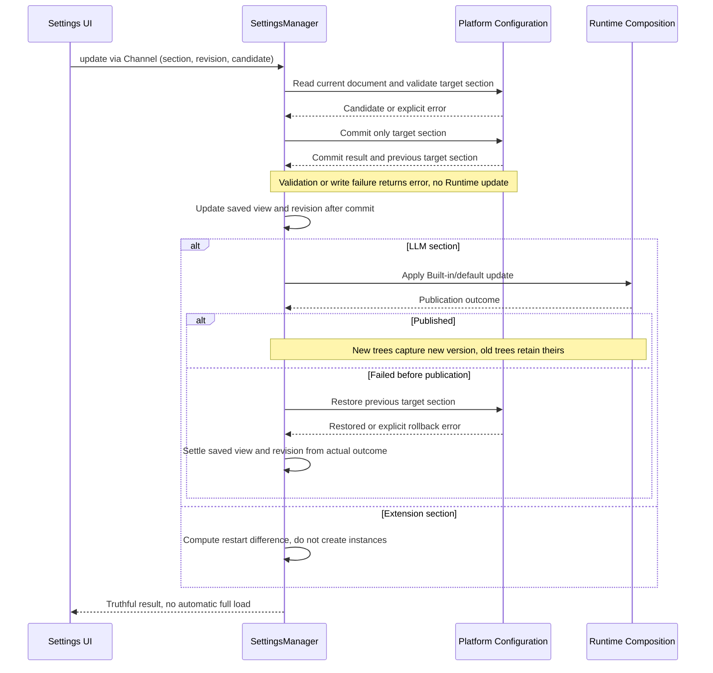

# Dynamic Settings Specification

> Status: Validated
> Date: 2026-11-10
> Owner: Project owner
> Design acceptance: Owner confirmed design and DS-0 readiness completion on 2026-11-10
> Related Plan: [Dynamic Settings Plan](plan.md)
> Implementation: Implemented and validated; owner directed completion and commit before phase-two Agent management on 2026-11-10. See the Plan's closeout and bounded validation evidence.

## 1. Scope and ownership

This Change defines the first-version Settings workflow for a personal local
Agent, not a remote administration system.

- Runtime owns SettingsManager, application coordination and Runtime publication.
  Prefer one internal component; Runtime Builder wires it into Channel capabilities.
- Platform Configuration owns file I/O, raw document preservation and configuration
  validation. Runtime does not directly read or write configuration files.
- Extension acquisition owns Descriptor discovery, Schema metadata and controlled
  loading. Settings reuses import-free discovery, not a second scanner.
- Core Channel owns the narrow transport-neutral action contract. Concrete Channels
  adapt it; bundled WebSocket owns the first Settings UI.
- Registry builder and lifecycle owners remain authoritative for registration,
  snapshot assembly, instance reuse and cleanup.

Agent Home `config.json` remains the sole persistence source. No users, roles or
management permission layer is added; existing local boundaries and Tool/Session
approvals remain unchanged.

## 2. Actions and section boundaries

Use one `settings_action` transport request with `requestId`, `action` and
`input: unknown`. Its transport `type` is not an extra required field of the
internal SettingsManager contract. Results correlate the request and distinguish
success from explicit failure. Unsupported actions fail without negotiation or fallback.

| Action | Behavior |
|---|---|
| `load` | Full safe Settings view, Schema/metadata, revisions, current model directory and restart-required state |
| `update` | Complete editable candidate for one section, section ID and expected revision |
| `test_llm_model` | Test one model; Built-in may use candidate settings, Extension uses current loaded instance |

The first-version contract below keeps domain input/results generic at
the Channel boundary; SettingsManager validates and types each action internally.
Do not introduce a new Channel event for every future domain action.

```ts
interface SettingsActionRequest {
  readonly requestId: string;
  readonly action: string;
  readonly input: unknown;
}

type SettingsActionResult =
  | {
      readonly requestId: string;
      readonly action: string;
      readonly ok: true;
      readonly output: unknown;
    }
  | {
      readonly requestId: string;
      readonly action: string;
      readonly ok: false;
      readonly error: {
        readonly code: string;
        readonly message: string;
        readonly fieldPath?: string;
      };
      readonly output?: unknown;
    };

interface SettingsCapability {
  execute(request: SettingsActionRequest): Promise<SettingsActionResult>;
}
```

Add `settings` to ChannelRuntimeCapabilities and expose the same capability to
embedding callers through Runtime's application boundary. WebSocket adds transport
types `settings_action` and `settings_action_result`, not domain unions to Agent
execution events. Runtime Builder creates/wires SettingsManager; Channel never
imports its implementation. Expected request failures return `ok: false`; unexpected
failures are logged and returned with a safe message when a response is possible.
Error `output` reports the rollback outcome and safe confirmed section/revision
when a write occurred before application failed, not as a success-shaped fallback.
If the file state cannot be confirmed, say so instead of presenting cached values
as the actual file state.

- One LLM section contains Built-in connection, full editable model list and
  global default-model reference.
- One section per discovered Extension contains its enablement and full editable
  scoped configuration; Extension parameters are not duplicated in LLM.
- No global Extension switch section exists.

Use section IDs `llm` and `extension:<descriptor.id>`. `load` takes `{}` and returns
`{ sections, modelCatalog, diagnostics }`; `diagnostics` also retains startup
discovery failures without an editable Descriptor. Each section contains its ID, revision, safe settings,
form metadata and `restartRequired`. Extension entries also carry existing discovery/
loading diagnostics. `modelCatalog` is the existing current Runtime projection,
not a candidate directory rebuilt from saved Extension parameters.
Within Settings responses only, Providers additionally carry optional
`configurationSectionId`: `llm` for Built-in, or the discovered Extension section
of the Unit that actually registered the Provider. No mapping is inferred from a
Provider name/ID; missing ownership or editable metadata leaves the link absent.
The shared Model Catalog contract is unchanged. The browser groups navigation
into LLM and Extensions; list/detail navigation does not change these section
boundaries or duplicate Extension drafts.

`update` takes `{ sectionId, expectedRevision, settings, credentials }`. The
successful output is `{ section, modelCatalog? }`: return the confirmed section,
and a new model directory/default projection for LLM updates. Extension updates
need not refresh unrelated model views.

```ts
type CredentialChange =
  | { readonly operation: 'keep' }
  | { readonly operation: 'replace'; readonly value: string }
  | { readonly operation: 'clear' };
```

`credentials` maps supported field paths to these intents: `/builtin/apiKey` in
LLM and `/<property>` for the existing supported root-level Extension `writeOnly`
string fields. It defaults to keep for omitted existing credential paths. Safe
settings omit credential values; separate field metadata indicates whether a
credential is configured and its literal/environment source, without returning
the credential. Keep never becomes clear because an empty form is submitted.
Unknown credential paths are rejected; no arbitrary path mutation facility.
Nested/composed sensitive Schema forms are not introduced in this first version;
unsupported forms are explicitly marked rather than exposing or silently dropping
their values. Read-only/unopened values remain server-owned.

`test_llm_model` takes `{ reference, builtin? }`, where `reference` is the existing
providerId/modelId pair. Optional `builtin` carries candidate connection/model
settings as `{ settings: { baseURL, models }, credentials?, expectedRevision? }`.
Credential intents use the same `/builtin/apiKey` path as update; retaining a saved
credential requires the matching LLM expectedRevision. Replacement/clear do not
retain that saved credential. Omit `builtin` to test the current loaded Provider,
including the loaded Built-in. Extension tests reject candidate settings.
Use a fixed,
small test prompt and existing Provider resolution/invocation contracts; do not
create a Runner Turn, Transcript or Session history for a test. Return the selected
reference and actual call outcome, without credential or upstream payload dumps.
Successful output is `{ reference, outcome: 'completed' }`; failures use explicit
error codes and include the validated reference when available, not response text
or raw upstream errors. This remains an action on `settings.execute`, not a
separate Channel interface or a generic section-testing contract.
Model Test has a fixed 30,000 ms deadline, accepted by the owner on 2026-11-10.
Start it when admitted Test preparation/resolution begins, before any upstream
invocation; preparation consumes the same deadline. On timeout, abort the invocation
signal and return an explicit timeout error, without retry. Shutdown can cancel
earlier. Clear timers/listeners when the request settles; still-used temporary or
generation references remain protected until actual cleanup completes, including
noncooperative calls after the timeout result. Reuse existing invocation signals
and shutdown cleanup reporting, not a generic Settings task framework or a new
user-configurable timeout setting.

Load reads the current saved editing view, existing discovery metadata and Runtime
directory, without network probing, Extension reinitialization or external-file
refresh. Saved Extension settings and loaded model facts are distinct.

## 3. Save, validation and concurrency

Each section has an in-memory random UUID revision at startup and after committed
updates. Load does not change it. A stale expected revision rejects the save.
Serialize each update from revision check through file write, Runtime application
and any required file rollback because sections share one document. The next update
must not enter this sequence while rollback is pending. Load must not expose an
intermediate candidate as a completed save.

The configuration layer reads the current file as the commit base, replaces only
the target section's editable content and preserves other sections. It must not
write an entire stale consumer snapshot back to the file. Read/parse/validation
failure reports an error rather than falling back to old data.

Both client and server validate structure and declared supported Schema constraints;
the server independently validates revisions and editable boundaries regardless of
enablement. Input may be temporarily invalid while editing, but cannot be submitted
as valid. Saving does not probe server reachability, credential correctness or
environment variable availability, nor instantiate an Extension.

- Literal credentials satisfy applicable declared value constraints.
- Supported exact environment references are checked for reference syntax only;
  value pattern/length checks follow materialization at startup. Client validation
  must not reject a legal reference against a literal-key constraint.
- Extension URL semantics come from declared Schema and its own startup logic,
  not a SettingsManager field-name heuristic. No new generic URL format support.
- Built-in retains its owner-defined protocol, endpoint, model and limit validation.

Secret intent is explicit: keep, replace or clear. Keep preserves raw environment
references, never their resolved value. Hidden/read-only/unexposed fields remain
server-owned and cannot disappear just because a form omits them. Editable model
lists replace the list; deleted models must not be merged back. Preserve unopened
fields on retained model identities without inventing a general deep-merge engine.

Model references use currently determinable facts: Built-in candidate registrations,
current Extension model facts and explicit enablement. Do not claim that new
Extension parameters will expose the same models after restart; failed resolution
never silently selects another default.

Successful save returns safe canonical values, revision and actual application
status, plus affected views as necessary. Client updates those views without
normal full reload. Revision conflict requires Reload and re-edit or abandon/close;
there is no old-draft merge or force-save flow. A timeout without a result is not
a known revision conflict; reload can establish actual saved state.

External editing protection and general automatic recovery are excluded. A section save
may overwrite external edits to that section; concurrent external writes are not
claimed to be protected by revision or file CAS.

### 3.1 Configuration-layer save interface

Add one section-write entry point to existing Platform Configuration, tentatively
`saveAgentConfigSection`. It accepts Agent Home, the LLM or identified Extension
edit, credential intents and the applicable static Schema metadata. Revision checks
remain in SettingsManager, not in the file format or configuration layer.

Within SettingsManager's serialized commit, the configuration layer:

1. Reads/parses the current raw document.
2. Builds the target section from editable values and explicit credential intent,
   retaining unexposed fields and all other sections.
3. Executes document/leaf format validation without credential materialization,
   network calls or Extension factory execution.
4. Writes an exclusively created same-directory temporary file, then replaces
   `config.json`; cleans the temporary file and reports errors explicitly.
5. Returns the committed raw document and the target section's pre-write raw value
   (including whether it was absent) to its server-side caller. There is no
   second file read after the write and no raw document returned to Channel/UI.

Reuse the Platform-owned reliable exclusive temporary-file and rename mechanics;
Runtime does not call Host initialization. The old wizard is removed.
Do not introduce a repository/storage abstraction or a file-change-detection policy.
Startup loading and this save operation share owner validators but differ in
materialization: extend existing configuration loading to retain the raw editing
document server-side, alongside immutable consumer projections. SettingsManager's
ordinary load uses that raw saved view, not a new file read.

After file commit, SettingsManager records the committed view/revision internally,
but settles the update result only after application or required rollback. For LLM it
materializes the relevant Built-in credentials using the startup environment and
existing helpers, then calls Runtime with the narrow LLM consumer input; Extension
save leaves materialization until restart. Unavailable Built-in credentials at
this application stage are application errors, not a rejection by the
save-format validator; they trigger the bounded rollback below.

#### Bounded file rollback

Owner accepted target-section file rollback on 2026-11-10. If an LLM write succeeded
but application fails before the new Runtime generation is published, restore that
update's pre-write target section through Platform Configuration before admitting
the next update. Restore raw credentials/references and original absence exactly,
preserve other sections, and reuse the same temporary-file/replace mechanism.
Do not restore an entire stale document. Keep the pre-write value only for the
in-flight update and release it on completion, including failure.

Runtime must distinguish failure before publication from errors after publication;
a generic exception alone is not proof that the old generation remains current.
Once publication succeeds, retirement/cleanup or later model invocation errors do
not trigger file rollback. Extension saves still require restart and have no
Runtime application step to roll back.

- Rollback succeeds: return an explicit application-failed/rolled-back error with
  the restored safe section and a fresh revision. Client updates its confirmed
  section/revision, explains that the save was restored, and need not perform a
  full load. Do not retain the pre-write revision after a committed rollback.
- Rollback fails: return an explicit error describing both application and rollback
  failure, and log both without secrets. Report the last confirmed persisted
  section/revision or explicitly unknown file state, never successful restoration.
  Do not set a permanent `faulted` gate or reject queued/future updates merely for
  this failure; each later update reads the current file and validates normally.
- Later Runtime updates compare with the current applied LLM input, not a previous
  failed candidate. Each rollback restores only that request's pre-write section;
  it does not claim to repair divergence left by an earlier rollback failure.

No persistent backups, automatic retries, crash recovery or online repair workflow
are introduced. This is compensation for a known pre-publication failure, not an
atomic transaction between the file system and Runtime.

### 3.2 Settings requests during shutdown

Runtime Builder closes SettingsManager admission when Runtime shutdown begins,
alongside composition admission and before waiting for Turns. Reuse the same
shutdown budget; Channel disconnection is not the shutdown signal.

- Reject new `update` and `test_llm_model` requests with an explicit closing
  error. Cancel queued updates and recheck closing immediately before entering
  the file-commit operation, so requests still preparing cannot write later.
- An already-started file commit settles according to the actual write result.
  Do not start a new Runtime application after closing; already-admitted composition
  work follows existing shutdown convergence. If an LLM write committed but no
  new generation was published, perform the same bounded rollback as part of this
  admitted update, even after closing. Use the shared remaining shutdown budget
  and report actual completion or residual file/rollback state. Do not roll back
  a published generation, or replay an update on restart.
- SettingsManager owns cancellation and cleanup of its active model Tests.
  Combine shutdown cancellation with existing test timeout/cancellation signals,
  including the race between request admission and invocation. Stop starting
  upstream work once closing; abort active calls and release temporary objects
  and protected instance/generation references when their use actually ends.
- Start cancellation at shutdown admission and await Settings convergence before
  composition-owned instances are stopped, within the shared remaining budget.
  A deadline is not proof that file I/O or upstream work was cancelled. Report
  failures/nonconvergence through the existing shutdown report and logs, retaining
  protection for still-used instances rather than claiming successful cleanup.
  Return request results where transport permits; do not keep Channels open
  indefinitely to deliver them.

This adds only SettingsManager admission/cancellation and a bounded close hook to
the existing Runtime shutdown path, not a generic task registry or recovery system.

## 4. Runtime application and resource lifetime

| Category | Application |
|---|---|
| Built-in connection and model registrations | Dynamic; new Root execution trees use published configuration |
| Default model, including an Extension model | Dynamic; no recreation of unchanged Provider instances |
| Extension parameters and per-entry enablement | Manual restart; current instances do not change |

Root captures the required immutable configuration with its Registry generation;
Children inherit the same execution-tree version. Existing trees retain their
Provider, defaults and applicable execution inputs through retries and delegation.
Do not mutate shared consumer configuration in place.

Compose a new ordinary RegistrySnapshot from the current composition, replacing
the target Unit contribution and reusing unchanged instances. Do not add a
CompositeRegistrySnapshot type or reload Extensions because their saved parameters
changed in another section.

Continuous updates are a first-version requirement: publication and retirement
must not share a long-running admission slot. Short update coordination remains
serialized; old generation pins do not block later publication. Reuse existing
generation records and lifecycle ledger rather than a new version-management framework.
Settings retirement must not timeout-abort old execution trees.

After a retired generation has no execution-tree references, release its full
snapshot references. After a no-longer-shared instance stops successfully, release
its owner/instance references. Remove completed retirement-task references.
Keep necessary lightweight diagnostics and resources still referenced or awaiting
failed cleanup; do not stop shared Extension/Channel instances prematurely.
Shutdown must account for all outstanding retirements.

### 4.1 Minimum Runtime wiring

Keep one internal `applyLlmConfiguration` entry into Runtime composition for the
LLM input; do not generalize this into arbitrary Unit/configuration patch commands.
Default-model and Built-in fields are one update, but unchanged Built-in configuration
does not need a new Provider instance. Compare with the current applied LLM input,
not merely the last saved editing view; a prior unsuccessful application must not
make necessary rebuilding appear to be a no-op. This is a current-input fact,
not a persistent dual-state recovery framework.

The localized changes are:

| Owner | Required change | Existing mechanism to reuse |
|---|---|---|
| Runtime composition manager / Unit catalog | Accept the target Built-in factory for initial addition or same-ID replacement; reuse all unchanged active Units; identify retired instances by instance identity, not only Unit ID | `createBuiltinLlmProviderUnit`, Unit staging and Registry builder |
| CompositionCoordinator | Bind default-model selection to the captured generation; allow multiple old generations to retire using existing generation records; release completed snapshot references | Critical publication/capture gate, generation map and pins |
| RuntimeApp / Child orchestration | Use captured default selection instead of startup resources for Root resolution and model-catalog projection; keep Child inheritance | Root generation pin and Parent snapshot propagation |
| Reload coordinator | End submission at publication, allow next candidate while earlier retirement runs; retain update/shutdown coordination | Existing active-candidate and failure-cleanup path |
| Composition manager / lifecycle ledger | Track outstanding retirement tasks; release stopped owners and completed tasks; protect shared instances; include all tasks in shutdown | Generation memberships, `stopEligible`, shutdown budget |

Do not add a separate retirement list if the existing generation state is sufficient.
Do not merely remove the guard without changing its dependent completion checks.
Existing Unit enable/disable goes through the same composition owner; regression
tests must preserve dependency/required constraints and candidate cleanup. Changes
to pending/latest-wins behavior must not allow one acknowledged Settings save to
silently displace another: SettingsManager serializes requests through completion
of application and any required file rollback, not completion of retirement.

Default selection is captured with Provider facts, not mutated in shared startup
AppConfig. Future execution-parameter capture is not implemented here. Shutdown
continues to use its existing bounded convergence policy; normal Settings retirement
does not force-abort old work, and retirement failures use existing diagnostics/logging.



The diagram describes successful progression and error boundaries, not a file/
Runtime atomic transaction. Runtime preparation/publication internals are resolved
in DS-0/DS-1 using existing mechanisms.

## 5. Provider UI and model actions

LLM Settings starts with a Provider list and a default-model selector sharing one
LLM draft. Provider Details contains models and model actions; an Extension
Provider's separate Configure Extension link opens its owning configuration.
Built-in provides base URL/key editing and model add/edit/delete, including protocol,
optional relative endpoint, supported reasoning capabilities and owner-defined limits.
Advanced presentation must preserve existing fields.

Other Providers expose their own model lists. LLM does not offer their connection
forms or generic model add/delete; Extension Settings edits their Descriptor fields.

Owner-refined UI baseline after first-round manual testing:

- Built-in has no Configure/enable checkbox. Its connection form is always visible.
  Removing every model retains the configured URL and key; an untouched empty form
  must not create an absent Built-in when saving other LLM settings.
- Built-in model rows start compact. Edit expands one inline form; collapsing or
  switching forms retains draft fields. Add opens the new model immediately.
  Test, Set default and Delete are grouped and right-aligned.
- Built-in and Extension model lists mark the current draft default as Default.
  Set default updates the badge immediately, not the saved configuration; existing
  unsaved state continues to indicate that Save LLM is required.
- A fixed footer, outside the two-column sidebar grid, contains one latest-operation
  message and the relevant section's Save action, including Save LLM in Provider
  details. Feedback aligns with the content column and Save remains right-aligned
  on desktop and narrow screens. Scrolling does not hide them.
- Load, save and Test replace old feedback with pending and then confirmed success
  or failure. Local default/add/delete actions also replace earlier action messages.
  A late response cannot overwrite a newer message, including a disconnect warning.
  Success uses the theme success color, errors danger, pending accent, and
  informational messages muted. Persistent restart/stale diagnostics remain state,
  not competing operation-result messages.

- Test checks an actual selected model invocation, not only directory discovery.
  Explain configuration source and possible billing. It does not save, increment
  revision, publish a generation or alter default selection.
- Built-in Test may prepare a bounded temporary invocation object from the draft.
  Retained secrets require an appropriate revision check.
- Extension Test uses current loaded instances, with reference protection and
  timeout/cancellation cleanup; no temporary Extension initialization.
- Set default only changes LLM draft; saving LLM applies it to new execution trees.
- No loaded Extension models means no executable model test/default selection
  from that Extension yet. Configure and restart first, then use the normal LLM flow.

First Provider configuration uses the same flow as subsequent edits. Per owner's
2026-11-10 amendment, a wholly new Agent Home starts normally: the Host exclusively
creates missing `config.json` as `{}` through Platform and retries strict loading.
Existing invalid files remain fatal. No bootstrap Provider, Model invocation or
separate browser setup service is added. The old initialization wizard and its
exclusive dependencies are removed; Core still initializes Root Context.
Default-enabled installed Channels can expose Settings without saved entries.

## 6. Extension discovery, restart and errors

Remove legacy `extensions.enabled` and its configuration/acquisition
logic. Discovery reads validated Descriptor/entry metadata without importing code,
and retains information for all identifiable Extensions, including disabled ones.
Loading attempts all discovered candidates by default, including absent entries.
An absent entry supplies empty scoped configuration before Schema defaults.
Explicit `enabled: false` skips import. Individual configuration, import, factory
and optional Runtime lifecycle failures are diagnosed and isolated.
Settings enabled state and restart comparison use the same default.

Accepted cutover: reject any legacy `extensions.enabled` field with a clear
configuration error and removal guidance. For old `false`, instruct the user to
disable each unwanted entry before removing it; never silently migrate global false.
Update supported examples to omit the field. No automatic
migration is added. Owner accepted this policy with the design on 2026-11-10.

Update only directly affected contracts/docs/tests, not unrelated Extension APIs.
Import-free discovery and per-entry loading are distinct calls within the existing
acquisition flow; retain discovery metadata in its result so Settings does not
rescan or import Extensions on load.

Each Extension saves independently. After each committed save, compute its
`restartRequired` from the difference between its saved enablement/parameters and
the configuration captured at startup, not from whether it has ever been edited.
Keep that startup baseline unchanged during Settings saves. Compare server-side
configuration values, including retained credentials and raw environment references,
not masked client fields or serialized JSON formatting.

Saving A -> B -> A clears that Extension's restart requirement without restarting.
Other Extensions with outstanding differences still require restart; any overall
restart indicator reflects whether at least one Extension requires it. Multiple
saves can precede one manual restart. Closing a notification does not erase actual
differences. Settings does not shutdown or relaunch the service.
Startup materializes credentials, validates resolved values, and creates instances;
startup failures are reported and are not converted into successful loading.

Request failures return to the client where possible. Asynchronous cleanup or
post-disconnection errors use existing logs without secrets. Target-section rollback
is limited to the pre-publication application failure described in section 3.1,
with no background retry. Rollback failure must not be reported as an unchanged file.
Later invocation errors are not publication failures and do not trigger rollback.

## 7. Acceptance scenarios

1. Full load is safe and does not probe networks, initialize Extensions or advance revisions.
2. Complete LLM/Extension section saves preserve other file sections, unexposed fields
   and raw environment references; explicit secret clear/replace and model deletion work.
3. Stale revision is rejected; independent sections do not lose one another's writes;
   cross-restart revisions invalidate old editors. Normal success needs no full reload.
4. Client/server accept a legal `${TOKEN}` even under literal-key pattern/length
   constraints; no available environment value is needed to save. Literal values
   remain constrained and startup validates materialized values.
5. Built-in/default changes apply to new trees; old Root/Child retries and calls
   remain version-consistent. Extension saved changes stay unapplied until restart.
6. Two dynamic updates while an older execution tree remains active both complete,
   retaining the first update's changes and without aborting old work.
7. Repeated updates with no remaining old trees do not continually retain full old
   snapshots, stopped owners or completed tasks. Shared instances stay active;
   cleanup failure and shutdown retain truthful residual diagnostics.
8. Disabled Extensions remain discoverable/editable; only per-entry enablement
   controls loading after the legacy global switch is explicitly removed.
9. Model Test uses the correct draft/current source, makes no save/publication and
   releases resources on success, failure or cancellation; default selection stays local until save.
10. Read/parse/validation/write/application errors are explicit; no secrets leak,
    rollback is limited to known pre-publication application failures, no general
    repair is inferred, and restart guidance matches actual state.
11. Shutdown rejects new updates/Tests and cancels queued or still-preparing
    updates before file commit; releasing their queue/validation barriers later
    does not cause a write or invocation.
12. Shutdown during an admitted commit reports the actual write outcome and
    committed revision where applicable; no new Runtime application starts after
    closing. Exercise write failure, successful rollback when publication is
    prevented, and rollback failure/deadline exhaustion with truthful residuals.
13. Shutdown during a Test aborts the upstream signal and cleans up within the
    shared budget. Cooperative completion releases references before instance
    stop; noncooperative cleanup produces a residual and preserves protection.
14. For startup configuration A, saving Extension configuration B sets its restart
    requirement; saving A again clears it without restarting or recreating instances.
    Cover parameters and enablement, including retained credential values. Another
    Extension's outstanding change keeps the overall restart indicator set;
    closing the notification alone does not clear a requirement.
15. Inject a pre-publication failure after an LLM file commit. Restore only the
    original target section, including credentials and absence; preserve unrelated
    sections and the old Runtime generation. Return restored safe values and a fresh
    revision, requiring no full client reload. A queued update cannot write until
    rollback settles and must check its expected revision against the final state.
16. Inject rollback failure: both errors reach the client where possible and logs
    without secrets; no successful restoration is claimed. A subsequent valid update
    can succeed from the current file and applied Runtime facts without a permanent
    fault gate. Its rollback preimage is its own pre-write section. Retirement and
    later invocation failures do not initiate file rollback.
17. Pause an LLM update after file commit but before Runtime application settles,
    and separately pause its required rollback. Issue concurrent loads at both
    barriers; neither may present the intermediate candidate as a completed save.
    After successful rollback settles, a new load (and any pending loads that
    complete then) returns the restored safe values and fresh revision. Use
    explicit barriers, not timing-dependent sleeps.
18. With fake timers, verify an otherwise pending Test has not timed out at
    29,999 ms and aborts/returns a timeout at 30,000 ms. Preparation consumes that
    deadline, no invocation starts after cancellation, and shutdown may cancel
    earlier. Cover cooperative cleanup and noncooperative reference protection;
    no automatic retry or real paid invocation is required for these tests.
19. Without a configured Built-in, its details expose the connection form without
    a configure checkbox. Saving an untouched form keeps Built-in absent. Creating
    the first model saves normally; removing all models retains URL and credential
    intents and clears a deleted draft default.
20. Model rows initially collapse their forms. Switching or collapsing editors
    preserves model fields and advanced JSON; Add opens one new model for editing.
    Test, Set default and Delete remain grouped on the right.
21. Changing the draft default immediately moves the Default badge in Built-in
    and Extension model lists without a save. Provider details expose Save LLM;
    only that explicit save persists the draft selection.
22. Load/save/Test errors, including local validation errors, use one fixed footer.
    Retrying replaces old errors with pending and then success/failure. A later
    local action or disconnect message cannot be overwritten by an older response.
23. The footer is outside the sidebar grid: feedback aligns with content and Save
    stays right-aligned on desktop and narrow screens, even after scrolling and
    with long errors. Success/error/pending use the corresponding theme colors.
    Real-browser checks establish geometry/colors; DOM component tests establish
    structure, state transitions and submitted requests, not pixel layout.

Use focused existing tests plus behavior-scoped client and integration checks.
The research draft's earlier test runs prove only existing behavior, not delivery
of this Change.
