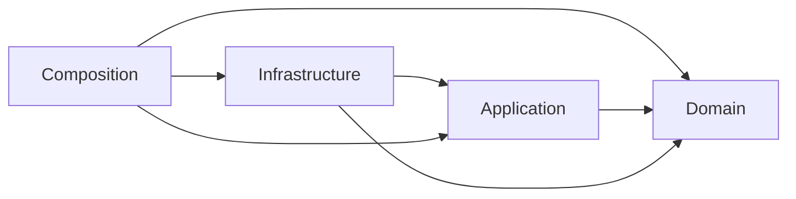

# Architecture Principles

## 1. Document Status

- **Status:** Accepted
- **Version:** 1.2
- **Date:** 2026-09-15
- **Owner:** Project owner
- **Source Plan:** [Archived Architecture Foundation Plan](../changes/archive/architecture-foundation/plan.md) AF-02
- **Canonical Terminology:** [Domain Glossary](domain-glossary.md)

This document defines stable constraints that ADRs, Specs, Current Architecture, and Architecture Slices must follow. The principles describe dependency direction, ownership, and verifiable outcomes. Current Architecture records the current directory, class, and interface structure; Accepted ADRs own long-term ownership decisions.

**v1.1 revision:** The project owner confirmed that AP-10 uses Extension/Module/Adapter instances as orchestration units within the Extension Framework. Each Extension continues to manage its own internal objects.

**v1.2 revision:** Following completion of Architecture Foundation, references to the unfinished AF-03 mapping were updated to reflect the established division of authority between Current Architecture and Accepted ADRs. The dependency direction principles are unchanged.

## 2. Applicability and Change Rules

1. `MUST`, `MUST NOT`, and "must" in this document express architectural constraints, not recommendations.
2. Target Architecture and Module Specs must identify applicable principles and validation methods.
3. Temporary exceptions must be documented in an `Accepted` ADR with their scope, rationale, owner, expiration date, and removal conditions.
4. If implementation evidence shows that a principle is not viable, pause the affected Slice and update the ADR or these principles first. Do not silently bypass the constraint in production code.
5. Changes to these principles require acceptance by the project owner and must be recorded through versions and Git history.

## 3. Dependency Direction

The architecture uses four logical boundaries. [Current Architecture](../architecture/overview.md) records the current directory mapping, and [ADR-007](../decisions/adr-007-builtin-capability-source-ownership.md) owns the long-term decision on builtin source ownership.



```text
Composition ─> Infrastructure ─> Application ─> Domain
      └────────────────────────> Application
      └──────────────────────────────────────> Domain
Infrastructure ──────────────────────────────> Domain

Domain/Application MUST NOT depend on Infrastructure or Composition.
```

Arrows indicate source code dependency direction, not necessarily runtime call direction. Application may call an Infrastructure Adapter through a Port that Application owns. The Adapter depends on the Port; Application does not depend on a concrete SDK.

## 4. Principles

### AP-01: Stable Core Does Not Depend on Concrete Integrations

**Principle:** Domain and Application must remain independent of Provider SDKs, Channel SDKs, concrete Stores, CLI/WebSocket Transports, and the Composition Root.

**Implications:**

- Core boundaries own the Ports and domain types they need.
- Infrastructure Adapters implement Ports and map external semantics.
- Adding a Provider, Channel, or Store must not require SDK-specific branches in the Runner, Session, or domain messages.
- External SDK types must not become part of core public contracts.

**Validation:** Dependency scans, public export checks, Fake Adapter Contract Tests, and change tests demonstrating that a second implementation can be added without modifying the core.

### AP-02: Configuration Inputs, Facts, and Policy Must Be Separate

**Principle:** Provider Connection, Model Descriptor, Model Policy, and per-turn Request Override must have distinct owners and merge stages.

**Implications:**

- Connection describes how to connect; it does not declare Model capabilities.
- Descriptor describes Provider/Model Facts; it does not include user preferences.
- Policy expresses permissions, selection, and fallback; it must not masquerade as facts.
- Request Override may override only explicitly permitted request parameters.
- Every final value must have a traceable source and precedence.

**Validation:** Resolver Unit Tests cover source precedence, conflicts, missing facts, and conservative fallback. Types and Schemas do not reuse a single field for multiple meanings.

### AP-03: Each Turn Consumes Exactly One Resolved Model

**Principle:** The Runner must consume an already resolved, immutable Resolved Model. It must not infer Model Facts again or assemble defaults from global configuration during execution.

**Implications:**

- Resolved Model binds Provider identity, the core-owned Port for model invocation, Protocol, Endpoint, and Model Capability facts together.
- Switching Models must switch all of these execution facts atomically.
- Once a Turn begins, changes to the Catalog, Policy, or global configuration must not change its Resolved Model.
- Parent Turns and Subagent Turns may resolve to different Models, but each must remain internally consistent.

**Validation:** Resolver/Runner Contract Tests; configuration-change tests during an active Turn; and an Integration Test in which the Parent and Subagent select different Providers/Models.

### AP-04: Builtin and External Capabilities Use the Same Extension Mechanism

**Principle:** Runtime Modules and External Extensions must provide Tools, Hooks, Channels, or other extension capabilities through the same Contribution, Registry, and Lifecycle Contracts.

**Implications:**

- Builtin capabilities must not bypass the Registry through a central list of special cases.
- An Extension may combine multiple Contribution kinds and share private resources within its own boundary.
- Adding an Extension must not require changes to Runtime, Runner, Bootstrap, or a central type union.
- Extension identity, configuration, and resources must not be reduced to a single Tool registration function.

**Validation:** Use an external test Extension that contributes a Channel, Tool, and Hook together. Builtin/External Contract Tests use the same test suite.

### AP-05: Registry Publishes Only Versioned, Immutable Snapshots

**Principle:** Registry consumers must read immutable Snapshots. Contribution changes must go through controlled pre-publish validation/failure cleanup, an atomic switch, and post-publish retirement.

**Implications:**

- A Turn captures a Registry Snapshot at startup and retains it unchanged throughout execution.
- New Turns see only the new version after the switch is complete.
- Consumers must not hold or modify the Registry's internal mutable collections.
- Pre-publish failures must not contaminate the current Snapshot. Candidate cleanup failures must be attributable and block subsequent changes. Post-publish retirement failures must not roll back a committed Snapshot; residual resources protected by pins must be observable and have a single Owner.
- Production integration in Slices 3/4 uses only a startup-time read-only Snapshot. Production runtime changes are enabled only after Slice 5 completes the full transaction lifecycle.

**Validation:** Snapshot immutability tests, concurrent old/new Turn tests, failure injection, draining checks, and resource leak checks.

### AP-06: Each Concept Has a Single Source of Truth

**Principle:** Each domain concept must have exactly one authoritative type, one owner of facts, and one production runtime path.

**Implications:**

- Do not maintain separate mutable copies of the same facts in Config, Runtime, Runner, and Adapter.
- Derived views must be generated from the authoritative source and have an explicit lifecycle.
- Dual paths during migration may exist only through time-limited Compatibility.
- Duplicate types must not be assumed semantically equivalent merely because their field names match.

**Validation:** Type/export audits, call-path Characterization Tests, a Compatibility inventory, and Architecture Fitness Tests.

### AP-07: Compatibility Must Flow One Way into the New Core

**Principle:** Compatibility Adapters may only map Legacy inputs or public APIs into the new authoritative core. New code must not depend back on Compat or Legacy.

**Implications:**

- Compat handles only parameters, defaults, and error mapping; it must not retain ownership of business facts.
- Compat must not be exported from the main Barrel as a recommended API.
- Each Compat must have an owner, expiration date, Feature Flag/release rollback strategy, and removal conditions.
- Completing a Slice must produce a net reduction in Legacy. Permanent dual implementations must not be used to claim that migration is complete.

**Validation:** Fitness Tests prohibiting reverse dependencies, public export checks, Slice removal checklists, and Compatibility Reviews at expiration.

### AP-08: Extension Capabilities Must Be Minimal, Explicit, and Typed

**Principle:** An Extension may receive only the minimum Extension Capabilities needed for its declared responsibilities. It must not access Runtime private state or a general-purpose Service Locator. Runtime Modules and Adapters use explicit dependencies or core-owned Ports.

**Implications:**

- Extension Capabilities are defined by the providing boundary and explicitly granted by Composition/Policy.
- Platform-specific Tools operate through a restricted message context or the corresponding Extension Capability.
- Private Extension resources remain within the Extension boundary; do not register them as global services accessible to arbitrary code.
- If a required Extension Capability is unavailable, explicitly reject the operation, degrade functionality, or leave the corresponding Contribution unregistered.

**Validation:** Type-level context restrictions, Extension Capability denial tests, Extension Contract Tests, and dependency checks prohibiting access to RuntimeApp private state.

### AP-09: Public Behavior Must Be Protected by Explicit Contracts

**Principle:** Public API, Event, Error, concurrency, cancellation, and Lifecycle behavior must be explicit in Specs and protected by deterministic Contract Tests.

**Implications:**

- Incidental implementation behavior does not constitute a public contract.
- Event ordering, Tool Use/Result pairing, Abort, Shutdown, and resource release must have explicit owners.
- Contract Tests prioritize observable behavior without locking in unrelated internal structure.
- When external SDK behavior is unknown, run a Spike first. Do not substitute Mock assumptions for evidence.

**Validation:** Module Spec acceptance matrices, Contract/Integration Tests, and Spike Results from real Providers or protocols.

### AP-10: Resources Must Have a Single Lifecycle Owner

**Principle:** Each long-lived resource must have a single owner responsible for creation and release. Runtime Composition only starts Extension/Module/Adapter lifecycle units in dependency order and stops them in reverse order. Each unit manages and cleans up its own internal objects.

**Implications:**

- Specs must define each lifecycle unit's scope, draining policy, and idempotent stop behavior. Each Extension is responsible for sharing and cleaning up its internal objects.
- Holding a reference does not grant a consumer the right to close a resource.
- Disabling an Extension must wait until it has no users or cancel existing work according to a defined policy.
- Shutdown attempts to stop every started lifecycle unit that can be stopped safely, but must not hide failures or inspect internal objects.

**Validation:** Lifecycle Contract Tests, partial startup failure injection, repeated stop tests, concurrent drain/abort tests, and lifecycle unit stop-order tests.

### AP-11: Runtime Orchestrates Execution; Composition Builds the System

**Principle:** Runtime orchestrates queues, Turns, routing, Snapshot capture, cancellation, and Shutdown. Runtime Builder/Composition discovers, creates, connects, and starts Modules, Extensions, Registries, and Adapters.

**Implications:**

- RuntimeApp does not resolve Model Facts or recognize concrete Channel/Provider types.
- The Runner does not load configuration, discover Modules, or manage process-level resources.
- Composition may depend on concrete implementations but must not leak them back into Stable Core.
- Do not hide dependencies behind a general-purpose DI Container or Service Locator.

**Validation:** RuntimeApp/Runner responsibility tests, constructor dependency checks, and change-locality tests for adding Providers/Extensions.

### AP-12: Abstractions Must Be Justified by Current Evidence

**Principle:** Introduce an abstraction only when it removes real complexity, supports a confirmed second implementation, or establishes a testable boundary.

**Implications:**

- A Port/Registry has at least two implementations, or one real implementation and a Fake for independent validation.
- A Spike prototype does not automatically become a production abstraction.
- Do not add mechanical conversion layers without business value to simple call chains.
- Do not prebuild frameworks for non-goals such as a Marketplace, distributed Event Bus, or arbitrary hot loading.

**Validation:** ADR options/consequences, call-flow reviews, evidence of implementation counts and change locality, and reviews for removing unused abstractions.

### AP-13: Architectural Facts, Targets, and History Must Be Distinguishable

**Principle:** Current Architecture, Target Architecture, Specs, Plans, Spike Results, and Legacy documents must be clearly distinguished through status and links.

**Implications:**

- Do not present target designs as facts about the current implementation.
- Current Architecture must be supported by code, tests, or runtime evidence.
- Superseded documents must point to their successors and be removed from active authoritative entry points.
- ADRs and Results with long-term value preserve history through status; age alone does not make them Legacy.

**Validation:** Documentation index checks, status field checks, broken-link checks, and Legacy migration tables.

## 5. Fitness Test Candidates

AF-04 should prioritize automating the following rules. Specific tools are determined by AF-01 governance decisions and AF-04 implementation constraints.

| ID | Automated Rule | Related Principles |
|---|---|---|
| FT-01 | Domain/Application do not import Infrastructure or Composition | AP-01 |
| FT-02 | Provider/Channel SDKs appear only in their corresponding Integration Adapters | AP-01 |
| FT-03 | Runner does not depend on a global Config loader, Provider SDK, or mutable Registry | AP-02, AP-03, AP-05 |
| FT-04 | The new core does not depend on Compat/Legacy paths | AP-06, AP-07 |
| FT-05 | Extensions/Modules do not access RuntimeApp private state or a Service Locator | AP-08, AP-11 |
| FT-06 | Adding a Provider does not require Runner changes; adding an Extension does not require changes to central Runtime/Runner branches | AP-01, AP-04 |
| FT-07 | Registry consumers receive only Snapshots, not internal mutable collections | AP-05 |
| FT-08 | Public Events, Lifecycles, and Ports have corresponding Contract Tests | AP-09, AP-10 |
| FT-09 | Active architecture documents have a status; Legacy documents are not dependencies of new implementations | AP-13 |

Fitness Tests prevent known regressions; they do not replace behavioral tests, architecture reviews, or Spike evidence.

## 6. Design Review Checklist

Every new ADR, Spec, or Architecture Slice must address at least the following:

- [ ] Uses canonical terminology from the [Domain Glossary](domain-glossary.md).
- [ ] Identifies the applicable principles and validation evidence.
- [ ] Dependency direction does not point from Stable Core to concrete integrations.
- [ ] Facts, Policy, Connection, and per-turn inputs are not conflated.
- [ ] Public contracts, concurrency, Lifecycle, and Resource Ownership are explicit.
- [ ] Extensions receive only explicit Extension Capabilities; no Service Locator is introduced.
- [ ] Old and new authoritative paths, Compatibility, rollback, and removal conditions are explicit.
- [ ] Abstractions are supported by real implementations, Fakes, or Spike evidence.
- [ ] Document status clearly distinguishes Current, Target, Active Work, and Legacy.
