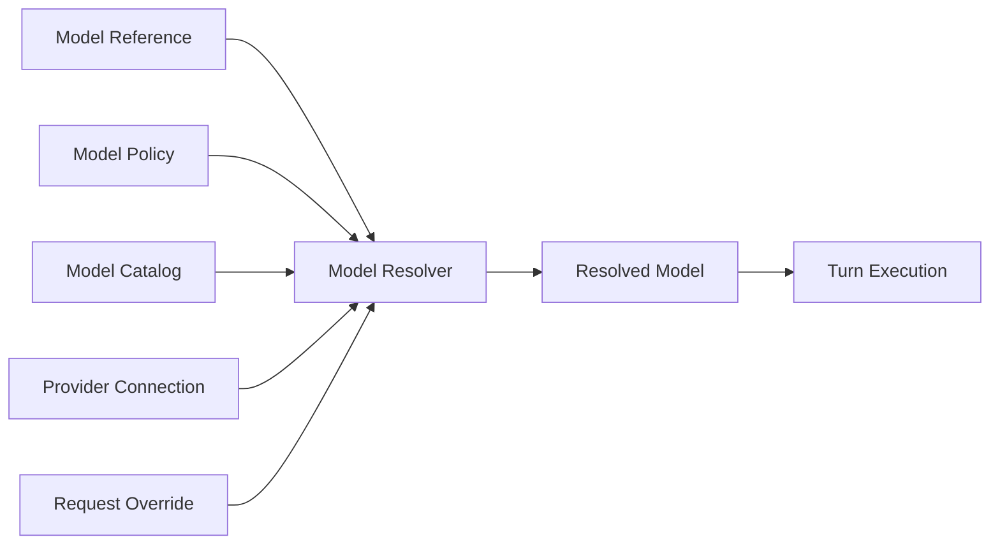
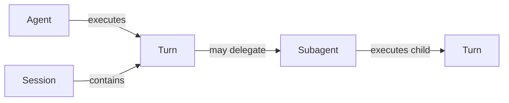
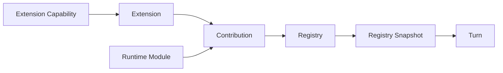
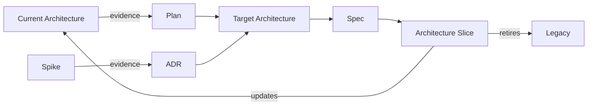

# Domain Glossary

## 1. Document Status

- **Status:** Accepted
- **Version:** 1.6
- **Date:** 2026-09-15
- **Owner:** Project owner
- **Source Plan:** [Archived Architecture Foundation Plan](../changes/archive/architecture-foundation/plan.md) AF-02

This document defines the canonical terminology used in the my-agent target architecture. The definitions express target semantics; they do not imply that the current implementation has completed the corresponding boundaries. Facts about the current implementation must still be assessed according to each document's own status.

**v1.5 revision:** The project owner confirmed that the minimum AF-06 scope of Reload Transaction covers only enable/disable operations. Runtime Builder orchestrates only instance lifecycles; each Extension manages its own internal objects.

**v1.6 revision:** Following completion of Architecture Foundation, the pending AF-03 mapping was replaced with the established division of authority among Current Architecture, Accepted ADRs, and stable Specifications. Canonical meanings are unchanged.

In this document, "owner" means the logical area of responsibility accountable for a concept's semantics and invariants. The glossary does not determine directory, file, class, or interface names. Where both Chinese and English names appear, the English name is the canonical term for code and architecture documents.

## 2. Usage Rules

1. A name expresses a single responsibility; it must not simultaneously mean configuration input, runtime facts, and execution policy.
2. New ADRs, Specs, and Target Architecture documents must use the terminology in this document.
3. If the current implementation uses the same term with different semantics, label that meaning as Current/Legacy rather than changing the canonical definition to match it.
4. Before a new concept becomes an architectural term, document its responsibilities, owner, and what it does not mean.
5. `Reference` denotes a stable reference, `Descriptor` describes facts, `Policy` defines selection rules, and `Resolved` denotes the immutable result of a single resolution.
6. `Adapter` connects external protocols or compatibility boundaries, `Registry` manages discoverable items, and `Runtime` orchestrates execution and lifecycle. These terms are not interchangeable.

## 3. Model Resolution

### Provider

- **Definition:** The stable identity of a service or protocol family that provides model invocation, such as Anthropic or an OpenAI-compatible service.
- **Responsibilities:** Identify where models are obtained and which integration module resolves and creates clients.
- **Owner:** Model Resolution owns identity semantics; Provider Integration owns concrete integration.
- **Does not mean:** An API Key, Endpoint, connected client, individual Model, or user selection policy.

### Provider Connection

- **Definition:** Deployment-level connection information needed to access a Provider instance, including credential references, Endpoint, tenant, or proxy settings.
- **Responsibilities:** Enable a Provider Adapter to establish a usable connection and isolate deployment differences. Configuration only loads the information and validates its format/Schema.
- **Owner:** Provider Integration.
- **Does not mean:** Provider identity, Model capability facts, Model selection, or per-turn parameters.

### Provider Integration Binding

- **Definition:** A contract-visible Provider integration binding selected and supplied by Composition for Model Resolution and Model Invocation.
- **Responsibilities:** Expose the selected Provider Contribution's core-visible contract capabilities to resolution and invocation without leaking the concrete integration implementation.
- **Owner:** Provider Extension Contract defines the semantics; Runtime Composition selects and supplies the concrete binding.
- **Does not mean:** Provider Connection, Provider Adapter, SDK Client, RuntimeApp state, Registry replacement, or a Service Locator.

### Protocol

- **Definition:** The wire protocol and semantic conventions used by a Provider Adapter and model service to exchange requests, stream events, Tool Use, and errors.
- **Responsibilities:** Determine message encoding, stream event interpretation, tool call format, and protocol error mapping.
- **Owner:** Provider Integration.
- **Does not mean:** A network transport library, Endpoint, Provider brand name, or generic domain message type.

### Model Reference

- **Definition:** A stable, serializable reference used by a user, Agent Profile, or caller to request a model.
- **Responsibilities:** Express which model is requested and serve as input to Model Resolver.
- **Owner:** Model Resolution.
- **Does not mean:** Complete Model Facts, a created Client, the final Endpoint, or the resolution result for a Turn.

### Model Descriptor

- **Definition:** A set of authoritative or conservative facts about a specific Provider Model, such as protocol, context limit, maximum output, media types, and capabilities.
- **Responsibilities:** Supply the Model Facts needed for resolution and execution budgeting, and record their sources.
- **Owner:** Model Catalog / Model Resolution.
- **Does not mean:** User preferences, default selection, request overrides, an API Key, or mutable runtime state.

### Model Policy

- **Definition:** Explicit rules for selecting or restricting candidate Models based on invocation context and user constraints.
- **Responsibilities:** Express permissions, preferences, fallback, and constraints without masquerading as Model Facts.
- **Owner:** Application Policy.
- **Does not mean:** Model Descriptor, Provider Connection, or the final execution configuration.

### Request Override

- **Definition:** A temporary model request override supplied by a caller for a single Turn, restricted to explicitly permitted fields.
- **Responsibilities:** Adjust parameters for the current request within Model Policy limits and preserve the override's source.
- **Owner:** The Turn input provider declares it; Model Resolution validates and applies it.
- **Does not mean:** Global configuration, Model Facts, Provider Connection, Model selection policy, or state persisted across Turns.

### Resolved Model

- **Definition:** An authoritative, immutable execution snapshot produced by Model Resolver for a Turn, binding Provider identity, the core-owned Port for model invocation, Protocol, Endpoint, Model Capability facts, and applied request limits.
- **Responsibilities:** Provide the Runner with complete model execution input that requires no further inference.
- **Owner:** Model Resolution produces it; Turn Execution consumes it.
- **Does not mean:** A Provider SDK Client, global default configuration, mutable Client singleton, Model Catalog entry, or reference that updates automatically across Turns.

### Model Resolver

- **Definition:** An application service that merges Model Reference, Provider/Model Facts, Model Policy, and permitted request overrides into a Resolved Model.
- **Responsibilities:** Validate sources, apply precedence, produce conservative results, and report unresolvable states.
- **Owner:** Model Resolution.
- **Does not mean:** A Provider SDK Adapter, the Catalog itself, the Runner, or a configuration loader.

### Model Catalog

- **Definition:** A queryable collection of Model Descriptors and their fact sources, organized by Provider and Model identity.
- **Responsibilities:** Supply traceable Model Facts to Model Resolver.
- **Owner:** Model Resolution.
- **Does not mean:** A Provider Connection Store, user selection policy, active Client Pool, or collection of defaults without attributed sources.

### Model Resolution Relationships



```text
Model Reference ─┐
Model Policy ────┼─> Model Resolver ─> Resolved Model ─> Turn Execution
Model Catalog ───┤
Provider Connection ─┤
Request Override ────┘
```

## 4. Agent Execution

### Agent Profile

- **Definition:** A configuration description that serializably references an Agent's identity, behavioral instructions, Model Reference, default policy, and capability constraints.
- **Responsibilities:** Allow callers and Runtime Composition to select an Agent role without writing runtime facts back into static configuration.
- **Owner:** Agent Application / Configuration.
- **Does not mean:** A running Agent, Session, Turn, Resolved Model, or Provider Connection.

### Subagent Profile

- **Definition:** An Agent Profile for delegated execution that additionally constrains the subtask role, tool policy, budget, and permitted nesting depth.
- **Responsibilities:** Allow a parent Agent to select Subagent behavior and limits through a stable reference.
- **Owner:** Subagent Orchestration / Configuration.
- **Does not mean:** An active Subagent execution, Child Turn, background task, concurrency commitment, or copy of the parent Session.

### Agent

- **Definition:** An execution role with an identity, behavioral instructions, default policy, and boundaries on available capabilities.
- **Responsibilities:** Provide stable role context and execution constraints for a Turn.
- **Owner:** Agent Application.
- **Does not mean:** An OS process, RuntimeApp instance, Session, individual Turn, or LLM Provider.

### Subagent

- **Definition:** An Agent execution delegated by a parent Agent to complete a bounded task using a separate role configuration and execution context.
- **Responsibilities:** Isolate subtask context, tool policy, budget, and results while preserving parent-child traceability.
- **Owner:** Agent Application / Subagent Orchestration.
- **Does not mean:** A background task, independent service, concurrency guarantee, copy of the parent Session, or arbitrarily recursive Agent Team.

### Session

- **Definition:** A conversation identity, history, and persistence boundary that lasts across multiple Turns.
- **Responsibilities:** Associate message history, branches, compaction records, and execution serialization policy for the same conversation.
- **Owner:** Session Domain.
- **Does not mean:** A network connection, Client, individual request, Agent identity, or running Turn.

### Accepted Request

- **Definition:** A caller request that RuntimeApp has accepted and assigned a stable `requestId`, but whose Root Turn has not yet started.
- **Responsibilities:** Support queuing, correlation, and caller settlement before Turn creation, and atomically transition to the corresponding Root Turn when execution begins.
- **Owner:** Runtime Application.
- **Does not mean:** A Turn, `turnId`, Registry Snapshot or generation pin, Resolved Model, Provider invocation, or proof that the Runner has started.

### Turn

- **Definition:** A traceable execution unit that begins with an accepted user input and ends when the corresponding Agent execution completes, fails, or is aborted.
- **Responsibilities:** Bind the Resolved Model, Registry Snapshot, cancellation signal, event correlation, and result for this execution.
- **Owner:** Turn Execution.
- **Does not mean:** An individual LLM call, individual message, entire Session, or Channel connection.

### Run

- **Definition:** The internal process by which the Runner executes a Turn, potentially including multiple LLM calls, Tool calls, and context compaction.
- **Responsibilities:** Describe the execution engine's process and result.
- **Owner:** Turn Execution.
- **Does not mean:** A Session lifecycle, Runtime lifecycle, or persisted background record for a Subagent.

### LLM Call

- **Definition:** An execution step within a Turn that uses the Resolved Model to issue a request to a model service and consume the resulting stream or response.
- **Responsibilities:** Represent one model protocol interaction and its Usage, Stop Reason, and error result.
- **Owner:** Turn Execution initiates it; Provider Adapter performs protocol mapping.
- **Does not mean:** A Turn, Session, Model Resolution, or complete Tool Use Loop.

### Agent Execution Relationships



```text
Agent ─executes─> Turn <─contained by─ Session
                   │
                   └─may delegate─> Subagent ─executes─> child Turn
```

## 5. Extension Framework

### Agent Home

- **Definition:** The canonical root directory where my-agent manages local runtime data, configuration references, and installed External Extensions.
- **Responsibilities:** Provide a resolvable persistent location across deployments and serve as the parent boundary of `<agent-home>/extensions`.
- **Owner:** Runtime Composition / Configuration.
- **Does not mean:** A Workspace, current working directory, Extension Registry, arbitrary scannable directory, or process-global state.

### Extension Discovery

- **Definition:** A startup process that enumerates and statically validates candidate Extension Descriptors from the canonical installation root before executing Extension code.
- **Responsibilities:** Identify candidates in immediate subdirectories, produce deterministic ordering, and report installation diagnostics discoverable without executing code.
- **Owner:** Runtime Composition.
- **Does not mean:** Extension Loader, Contribution registration, runtime reload, Marketplace search, or scanning `node_modules`.

### Extension Descriptor

- **Definition:** The static identity and loading description expressed by `extension.json` in an External Extension's installation directory.
- **Responsibilities:** Supply loading facts such as Extension identity, version, and entry point before code execution, and support static validation.
- **Owner:** Extension Framework defines the contract; the Extension author supplies the concrete description.
- **Does not mean:** Extension runtime configuration, a Contribution collection, loaded code, private resources, or a Registry Snapshot.

### Extension Loader

- **Definition:** A Composition component that loads an External Extension entry point from a validated Extension Descriptor and adapts it so the unified registration entry point can be invoked.
- **Responsibilities:** Isolate module loading mechanisms and errors, and pass successful results to the Extension registration stage.
- **Owner:** Runtime Composition.
- **Does not mean:** Extension Discovery, Registry mutation, a Service Locator, a Contribution consumer, or a runtime hot-swap mechanism.

### Tool

- **Definition:** A capability that an Agent may request to execute, with a name, input contract, result semantics, and explicit side-effect boundaries.
- **Responsibilities:** Expose controlled operations to Turn Execution and return structured success or error results.
- **Owner:** Tool Domain; the corresponding Module or Extension owns the concrete implementation.
- **Does not mean:** An arbitrary function, Provider API, Hook, Channel, or undeclared Runtime access.

### Application Tool Policy

- **Definition:** An Application Policy that returns a `deny`, `allow`, or `requiresApproval` decision for a normalized, schema-valid effective Tool Call. An explicit deny takes precedence over an allowlist.
- **Responsibilities:** Determine whether a Tool Call may execute or requires approval based on explicit deployment and Agent Policy inputs, without performing approval interactions or executing the Tool implementation.
- **Owner:** Application Policy.
- **Does not mean:** A Tool Contract, schema validator, Hook, Channel Capability or approval transport, Registry, or Tool executor.

### Channel

- **Definition:** An I/O Adapter that receives user intent, sends events, and provides optional interaction capabilities between an external Client/Transport and Runtime.
- **Responsibilities:** Handle transport, connections, routing identifiers, and presentation, without implementing Agent decisions or the Tool Use Loop.
- **Owner:** Channel Integration.
- **Does not mean:** A Session, Client identity itself, Agent Runner, business policy, or general-purpose Event Bus.

### Hook

- **Definition:** An extension point that observes, supplements, or contractually influences execution at a named Runtime or Turn lifecycle point.
- **Responsibilities:** Execute bounded cross-cutting logic without replacing the core Runner.
- **Owner:** Stable Core owns the Hook Contract; a Module or Extension owns the implementation.
- **Does not mean:** Arbitrary middleware, global event listening, Runner Factory replacement, or a backdoor into Runtime private state.

### Extension

- **Definition:** An installable, loadable unit of extension code with its own identity, configuration namespace, private resources, and set of Contributions.
- **Responsibilities:** Provide one or more extension capabilities to Runtime under bounded Extension Capabilities and a unified Lifecycle.
- **Owner:** Extension Framework governs the contract; the Extension author owns the concrete implementation and private resources.
- **Does not mean:** An individual Tool, Contribution, remotely downloaded package, arbitrary runtime code hot loading, or a synonym for Runtime Module.

### Runtime Module

- **Definition:** A builtin functional unit supplied directly by the application build and deployment that uses the same Contribution and Lifecycle mechanisms as an Extension.
- **Responsibilities:** Register Builtin Tools, Channels, Hooks, or other capabilities with Runtime in a uniform way.
- **Owner:** Runtime Composition; each concrete Module owns its implementation.
- **Does not mean:** A Node.js module, arbitrary source directory, External Extension, or the Composition Root itself.

### Contribution

- **Definition:** A typed, validatable capability declaration and implementation binding submitted to Registry by an Extension or Runtime Module.
- **Responsibilities:** Describe what is contributed so Registry can build a Snapshot without recognizing concrete Extension types.
- **Owner:** Extension Framework defines the contract; the contributor supplies the instance.
- **Does not mean:** The Extension itself, a published Snapshot, direct mutation of Registry collections, or ungoverned startup side effects.

### Capability

- **Definition:** An umbrella term for explicit authorization or supported functionality. Architecture documents and code must use one of the qualified terms below.
- **Responsibilities:** Provide a shared root term for authorization boundaries and support facts, not serve directly as an interface or field type.
- **Owner:** Domain Glossary governs the umbrella term; qualified terms define concrete ownership.
- **Does not mean:** A unified Capability type, general-purpose Service Locator, access to arbitrary objects, or implicit permission.

### Extension Capability

- **Definition:** A typed permission explicitly granted to an Extension for access to bounded Runtime services or platform context.
- **Responsibilities:** Restrict the Extension's accessible surface to the minimum declared and authorized set.
- **Owner:** The service-providing boundary defines it; Runtime Composition / Policy grants it.
- **Does not mean:** Model support facts, Channel functionality, a Tool list, private Extension resources, or a Service Locator.

### Model Capability

- **Definition:** A model support fact recorded in Model Descriptor, such as Tool Use, image input, or a specific protocol feature.
- **Responsibilities:** Allow Model Resolution and callers to validate requests against known facts and use conservative fallback.
- **Owner:** Model Catalog / Model Resolution.
- **Does not mean:** Extension permissions, Channel functionality, user Policy, or callable Runtime services.

### Channel Capability

- **Definition:** An optional interaction or transport feature a Channel may provide to Runtime, such as approvals, structured choices, or attachment input.
- **Responsibilities:** Allow Runtime to explicitly detect and use supported Channel features without recognizing concrete Channel types.
- **Owner:** Channel Contract defines it; the concrete Channel Adapter declares support.
- **Does not mean:** Extension permissions, Model support facts, Transport identity, or general Runtime access.

### Registry

- **Definition:** The single authoritative manager that validates, indexes, and publishes accepted Contributions across kinds.
- **Responsibilities:** Produce a versioned, internally consistent, immutable Registry Snapshot. Expose kind-specific access only through narrow typed projections of the Snapshot, and change the subsequently visible set through controlled transactions.
- **Owner:** Extension Framework / Runtime Composition.
- **Does not mean:** Independent Registries publishing separately for each Contribution Kind, a consumer-mutable `Map`, dependency injection container, Service Locator, Extension Loader, or Marketplace.

### Registry Snapshot

- **Definition:** An immutable, internally consistent view of Contributions for a Registry generation unique within a process.
- **Responsibilities:** Ensure that a Root/Child Turn tree observes a fixed capability set throughout execution. A generation expresses only publication order within the current process.
- **Owner:** Registry produces it; Turns capture and consume it.
- **Does not mean:** Registry itself, an Extension version, an ID persisted across restarts, a distributed consistency number, a deep copy of all Extension state, or live updates to active Turns.

### Reload Transaction

- **Definition:** An in-process state change that enables or disables an already loaded Extension, from candidate preparation through atomic publication of a Registry Snapshot.
- **Responsibilities:** Isolate and validate the candidate before publication, clean up candidates on failure or when superseded, and use one atomic publication as the successful completion point.
- **Owner:** Runtime Composition / Runtime Builder.
- **Does not mean:** Runtime version replacement or coexisting instances of the same Extension, rescanning or loading Extension code, Generation Retirement, a file watcher, a distributed transaction, or a long transaction that includes draining old instances.

### Generation Retirement

- **Definition:** A lifecycle process that independently closes ingress, drains the Turn tree, performs necessary Aborts, and stops eligible Extension/Module instances for an old generation after a new Registry Snapshot is published.
- **Responsibilities:** Retire the old generation safely without rolling back the published Snapshot, and stop instances no longer protected by generation pins.
- **Owner:** Runtime Builder orchestrates it; each instance's Lifecycle Owner executes `stop()` and cleans up its own internal objects.
- **Does not mean:** An unfinished phase of Reload Transaction, rollback of a published Snapshot, unloading Extension code, or a general-purpose task system permitting concurrent draining of multiple generations.

### Extension Framework Relationships



```text
Extension ───────┐                         ┌─> Turn
                 ├─> Contribution ─> Registry ─> immutable Snapshot
Runtime Module ──┘

Extension Capability ─grants bounded access─> Extension
```

## 6. Architecture Boundaries

### Domain

- **Definition:** The innermost logical boundary expressing core concepts, values, invariants, and behavior independent of concrete integrations.
- **Responsibilities:** Own stable domain semantics and remain verifiable without a Provider SDK, Channel SDK, Store, or Runtime.
- **Owner:** Stable Core.
- **Does not mean:** All shared types, a data access layer, Application use cases, an Infrastructure Adapter, or a predetermined source directory.

### Application

- **Definition:** The logical boundary that orchestrates Domain concepts, application policies, and core-owned Ports to fulfill use cases.
- **Responsibilities:** Coordinate application flows such as Model Resolution and Turn Execution without depending on concrete Infrastructure implementations.
- **Owner:** Stable Core.
- **Does not mean:** UI/Channel, Composition Root, a Provider SDK Adapter, a configuration file, or the entire Runtime process.

### Infrastructure

- **Definition:** The logical boundary that implements core-owned Ports and connects Provider SDKs, Channel Transports, Stores, file systems, or other external mechanisms.
- **Responsibilities:** Isolate external protocol, SDK, I/O, and deployment changes and map them to Stable Core contracts.
- **Owner:** The corresponding Integration Adapter.
- **Does not mean:** Business policy, Application use cases, Composition Root, or an umbrella term for all technical helper code.

### Composition

- **Definition:** The outermost logical boundary that selects concrete implementations, validates configuration, builds the dependency graph, and orchestrates process-level startup and shutdown.
- **Responsibilities:** Assemble Stable Core, Infrastructure Adapters, Runtime Modules, and Extensions into a runnable system.
- **Owner:** Runtime Composition.
- **Does not mean:** Runtime Turn/queue logic, business rules, a general-purpose DI Container, or a service collection accessible to any module.

### Stable Core

- **Definition:** The collective term for Domain, Application, and their public contracts, emphasizing independence from concrete Infrastructure and Composition.
- **Responsibilities:** Provide stable behavioral boundaries that can be verified independently and driven by different Adapters.
- **Owner:** Domain/Application maintainers.
- **Does not mean:** A single package, code that never changes, RuntimeApp, or a shared layer containing concrete SDKs.

### Composition Root

- **Definition:** The single entry point within Composition that actually selects concrete implementations and creates, connects, and starts the top-level object graph.
- **Responsibilities:** Pass explicit dependencies to consumers and hand execution responsibility to Runtime after construction.
- **Owner:** Runtime Composition.
- **Does not mean:** A Service Locator, global container, Runtime execution loop, or collection of factories repeated across arbitrary modules.

## 7. Runtime and Integration

### Port

- **Definition:** A contract owned by Stable Core that expresses which operations it needs an external boundary to perform.
- **Responsibilities:** Allow Application to depend on abstract behavior, with Infrastructure Adapters implementing external protocol, SDK, or storage integrations.
- **Owner:** The Domain/Application boundary that needs the behavior.
- **Does not mean:** A concrete Adapter, SDK Client, network port, generic interface collection, or abstraction mechanically created for every class.

### Adapter

- **Definition:** A boundary implementation that translates semantics between a core Port/Contract and an external SDK, protocol, storage system, or Legacy API.
- **Responsibilities:** Isolate external changes and map types, errors, events, and protocols.
- **Owner:** The corresponding Infrastructure Integration; the core owns the implemented Port.
- **Does not mean:** Business policy, Composition Root, a generic wrapper layer, or a forwarding object added to hide circular dependencies.

### Compatibility Adapter / Compat

- **Definition:** A temporary Adapter that maps a Legacy Public API or old inputs one way into the new authoritative core during migration.
- **Responsibilities:** Preserve confirmed compatibility behavior and specify an owner, expiration date, and removal conditions.
- **Owner:** The team or module that owns the migration Slice.
- **Does not mean:** Long-term dual implementations, an abstraction the new core may depend on, a backup of old logic, or a recommended public API.

`Compat` is used only as shorthand for `Compatibility Adapter`; it does not mean a general compatibility objective.

### Runtime

- **Definition:** The execution environment that hosts Session/Turn requests and coordinates queues, routing, Snapshots, cancellation, and process-level lifecycle.
- **Responsibilities:** Orchestrate resolved dependencies and runtime resources without owning the internal business rules of Providers, Tools, Channels, or Sessions.
- **Owner:** Runtime Application.
- **Does not mean:** Composition Root, Agent Runner, the Node.js process itself, or a global Service Locator.

### Runtime Builder

- **Definition:** A Composition service that builds Runtime dependencies, the Registry, and instance startup dependencies from validated configuration and loaded Modules/Extensions.
- **Responsibilities:** Create, connect, and start lifecycle units, and request that the corresponding instances clean themselves up on failure according to ownership rules.
- **Owner:** Runtime Composition.
- **Does not mean:** A manager of internal Extension objects, Runtime execution loop, configuration loader, Extension Marketplace, or container accessible from anywhere.

### Lifecycle

- **Definition:** The contract governing the states and ordering of a Module, Extension, Adapter, or Runtime through creation, validation, startup, availability, draining, stopping, and release.
- **Responsibilities:** Specify a lifecycle unit's creator, users, stop responsibility, failure cleanup, and idempotency requirements. Each Extension manages its own internal objects.
- **Owner:** Stable Core defines the public Lifecycle Contract; the instance Owner implements concrete behavior; Runtime Composition only orchestrates unit ordering.
- **Does not mean:** Merely two methods named `start()`/`stop()`, garbage collection, process signal handling itself, or implicit registration side effects.

### Resource Ownership

- **Definition:** Rules assigning sole responsibility for resource creation, sharing scope, usage counts, draining, release, and failure cleanup.
- **Responsibilities:** Prevent duplicate closes, resource leaks, and indeterminate shutdown order.
- **Owner:** The Module, Extension, or Adapter that creates the resource. Runtime Builder owns only Composition resources it explicitly creates directly; it does not acquire ownership of internal Extension objects.
- **Does not mean:** The Framework tracking membership/reference counts of internal Extension objects, JavaScript object references, permission for any consumer to close a resource, or reliance on Garbage Collection alone.

## 8. Governance and Documentation

### Current Architecture

- **Definition:** Facts about current production structure, call flows, and behavior verified by code, tests, and runtime evidence.
- **Responsibilities:** Explain how the system works now and link to validation evidence.
- **Owner:** Maintainers of the corresponding implementation modules; the project owner confirms authoritative entry points.
- **Does not mean:** Target designs, unimplemented Specs, Changes, Evidence, Deferred inputs, or outdated design records.

### Target Architecture

- **Definition:** Accepted target modules, dependencies, contracts, lifecycles, and migration boundaries.
- **Responsibilities:** Constrain Architecture Slices and subsequent Specs without masquerading as the current implementation.
- **Owner:** Project owner.
- **Does not mean:** Current Architecture, implementation progress, a vision checklist, or interface details that can be fixed without evidence.

### Plan

- **Definition:** A governance artifact describing cross-phase objectives, sequencing, Gates, risks, and exit criteria.
- **Responsibilities:** Determine why work is needed, in what order it proceeds, and which conditions must be met before advancing.
- **Owner:** Project owner.
- **Does not mean:** A Module Contract, implementation guide, or that `Accepted` means complete.

### Spec

- **Definition:** An implementable description of a module or behavioral boundary's public contracts, states, errors, concurrency, Lifecycle, and acceptance criteria.
- **Responsibilities:** Determine what the implementation must satisfy, without requiring the internal code structure to be prescribed in advance.
- **Owner:** Maintainers of the corresponding module or behavioral boundary; the project owner accepts it.
- **Does not mean:** Research notes, a Roadmap, Current Architecture, or an idea that may be implemented without acceptance.

### ADR

- **Definition:** An artifact recording a long-term, difficult-to-reverse architecture decision, its context, alternatives, evidence, and consequences.
- **Responsibilities:** Explain why an architectural direction was chosen and allow later evolution by superseding the decision.
- **Owner:** Project owner.
- **Does not mean:** Every small implementation choice, meeting minutes, a Spec, or an immutable permanent truth.

### Spike

- **Definition:** Time-boxed experimental work that tests a falsifiable architectural hypothesis, together with its Spec/Results.
- **Responsibilities:** Use execution evidence to reduce unknowns that could change architectural conclusions.
- **Owner:** The Spike executor is responsible for evidence; the project owner accepts the experiment and confirms the results.
- **Does not mean:** Production implementation, unbounded exploration, proving a predetermined conclusion, or a prototype that automatically enters production.

### Legacy

- **Definition:** Documentation, APIs, or implementations superseded by new authoritative facts or production paths but not yet fully migrated or removed.
- **Responsibilities:** Be tracked as migration targets with explicit exit paths.
- **Owner:** The Architecture Slice or documentation migration item replacing them.
- **Does not mean:** Something merely old, stable code that remains authoritative, or history that must be preserved through long-term copies.

### Architecture Slice

- **Definition:** The smallest acceptable delivery unit that migrates a real production caller or authoritative path under the constraints of accepted Target Architecture, ADRs, and Specs.
- **Responsibilities:** Deliver the target architecture through user-observable outcomes, focused and broader validation, Compatibility, and conditions for removing old paths.
- **Owner:** The implementer of the corresponding Plan Item is responsible for delivery; the project owner confirms completion.
- **Does not mean:** An arbitrary Sprint, layered refactoring that only adds abstractions, a Spike, an individual Commit, or a batch of code without removal conditions.

### Governing Relationships



```text
Current Architecture ─evidence─> Plan ─> Target Architecture ─> Spec ─> Architecture Slice
                                     ^                                │
Spike ─evidence─> ADR ────────────────┘                                ├─updates─> Current Architecture
                                                                      └─retires─> Legacy
```

## 9. Terms That Must Not Be Conflated

| Avoid | Canonical Expression |
|---|---|
| "model config" for model name, connection, and capabilities together | Model Reference + Provider Connection + Model Descriptor |
| "resolved config" for this Turn's model facts | Resolved Model |
| "provider" for a created SDK Client | SDK Client inside a concrete Provider Adapter |
| "session" for one execution | Turn |
| "turn" for one LLM API request | LLM Call |
| "extension" for a single Tool | Tool Contribution |
| "module" for an arbitrary source folder | Runtime Module or the specific code module name |
| "registry" for a mutable global `Map` | Mutable collection; the target Registry publishes only immutable Snapshots |
| "capability" for an arbitrary dependency | Use Extension Capability; Modules/Adapters use explicit dependencies or Ports |
| "adapter" for a forwarding layer without semantic translation | Use Adapter only for external/compatibility semantic translation boundaries |
| "legacy" for all old code | Only superseded paths awaiting retirement |
| "current architecture" for a design directory | Only current facts verified by evidence |

## 10. Established Authority Mapping

The glossary defines only conceptual semantics. Specific authority is assigned as follows:

- [Current Architecture](../architecture/README.md) records current directories, modules, public entry points, and implemented interfaces.
- [Architecture Principles](architecture-principles.md) defines dependency constraints for Domain, Application, Infrastructure, and Composition.
- [Decisions](../decisions/README.md) owns long-term choices about Provider/Model, Registry/Runtime lifecycle, Compatibility, and builtin ownership.
- [Specifications](../specifications/README.md) owns stable contracts for Config, Schema, Extension Capability, Resource Ownership, Registry transactions, Snapshots, draining, rollback, and shutdown.
- [Changes](../changes/README.md) and [Evidence](../evidence/README.md) retain only migration, removal, and validation records; they do not redefine canonical terminology.
