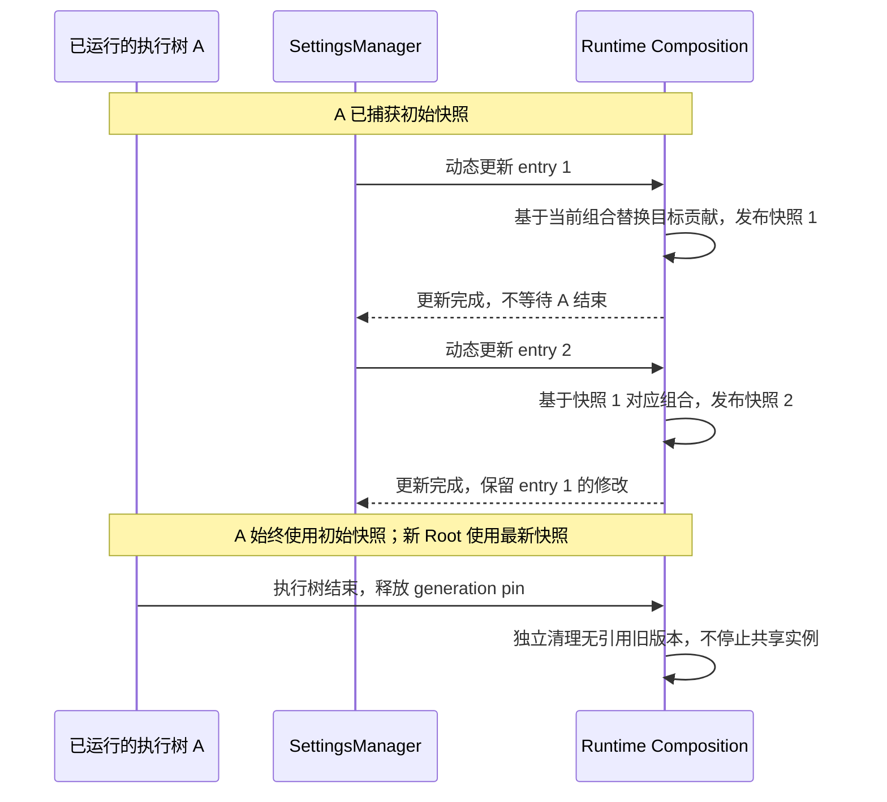
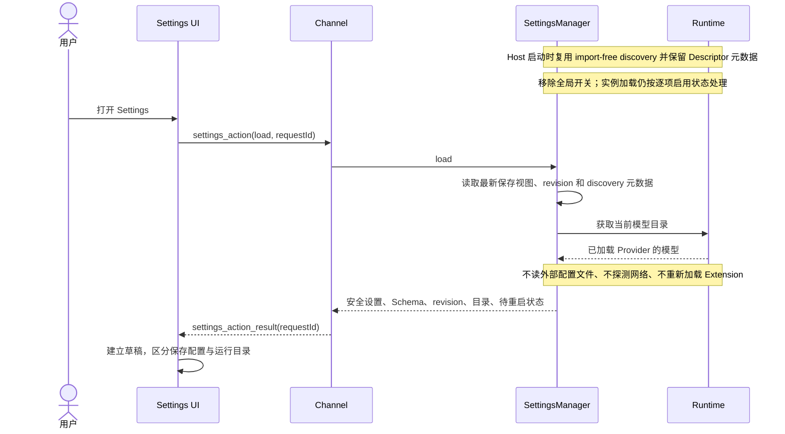
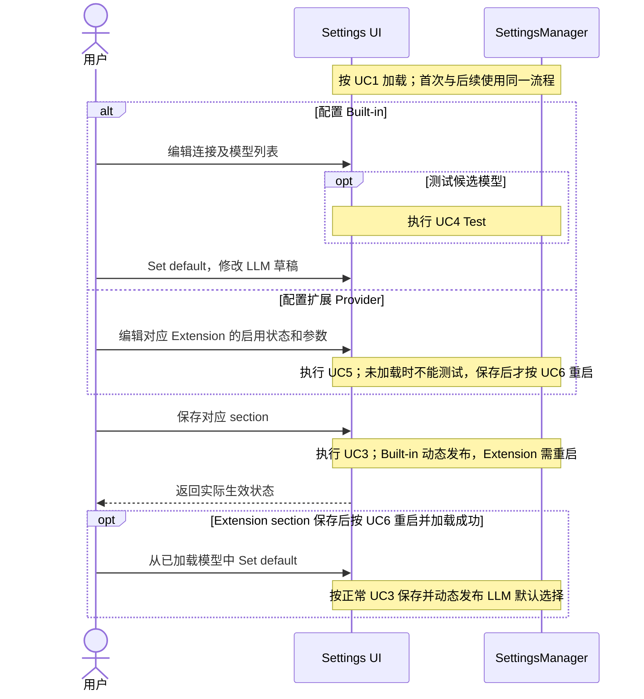
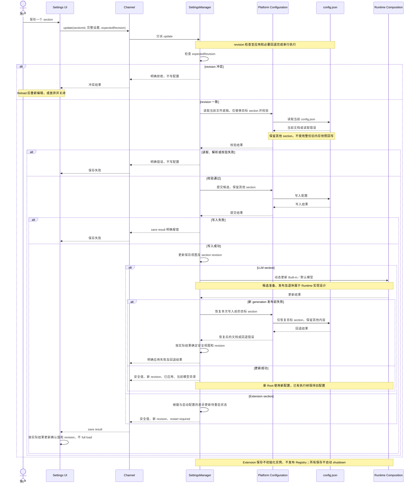
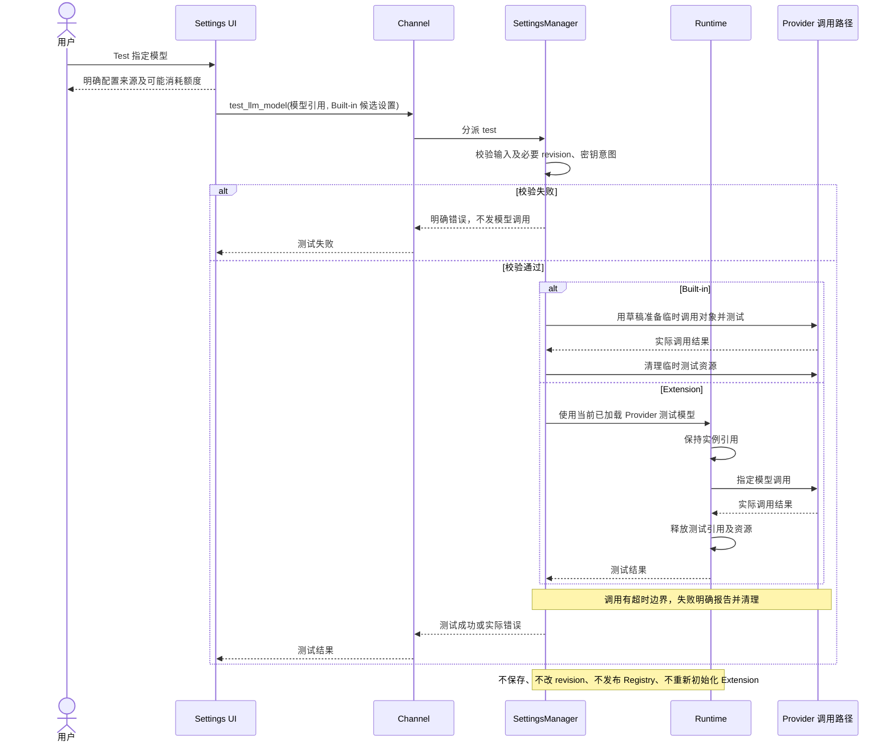
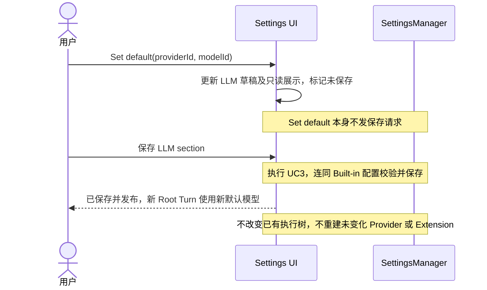
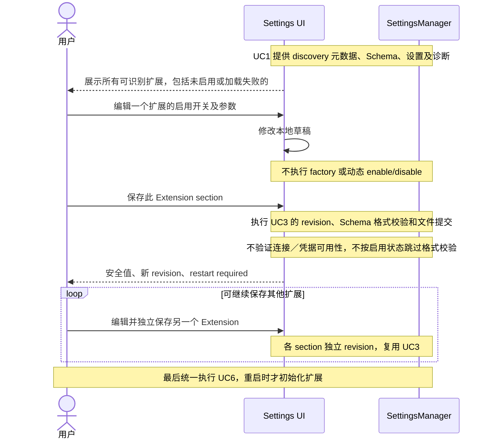
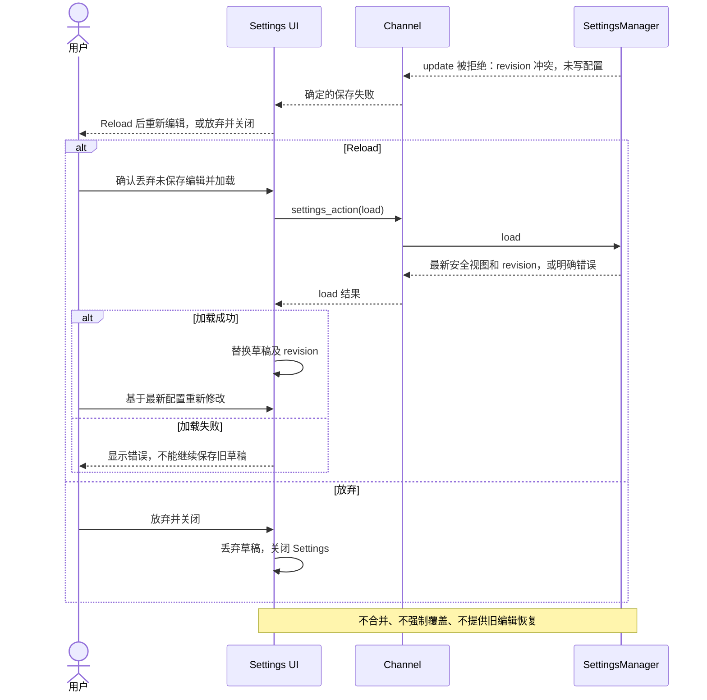
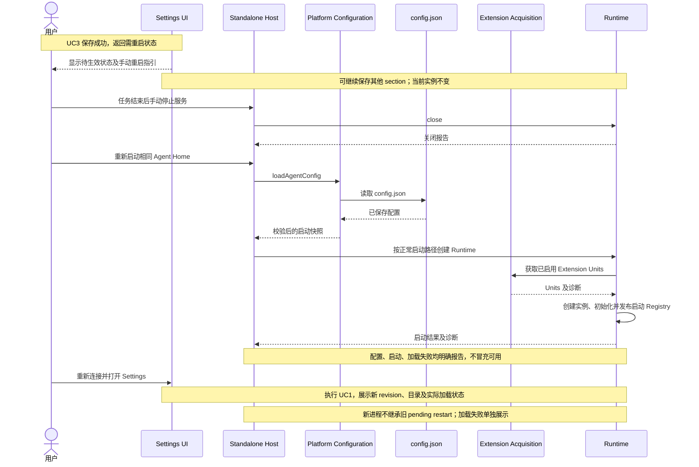

# Dynamic Settings 设计草稿

> Status: Non-authoritative design draft
> Authorization: 仅用于讨论，不授权实现，不覆盖 Current Architecture、Accepted Decisions、Stable Specifications 或源代码
> Date: 2026-11-09
> Change: [Dynamic Settings Plan](../changes/archive/dynamic-settings/plan.md) 和 [Specification](../changes/archive/dynamic-settings/specification.md) 已实施验证，2026-11-10 owner 授权收尾提交并归档。本草稿仅保留讨论来源，不是当前契约。
> Scope: 通用 Channel Settings 交互、Built-in LLM 与已发现 Extension 的设置、运行中配置保存及生效状态
> Discussion update: 已确认运行中 Turn 不受影响；协议内容保持通用；section revision 只在内存维护，启动及成功更新时生成随机值。其他建议和待决事项见下文。
> Discussion update: 2026-11-09，协议收敛为单一 `settings_action` 请求，load/update/test 等由 action 区分，不再分别设置 load/save 请求事件；具体动作内容仍待定稿。

## 1. 目标与非目标

客户端提供 Settings 入口，在服务运行中维护 LLM 设置；不是仅在聊天中选择已有模型。相同管理能力可以由 WebSocket、CLI 或其他 Channel 使用，传输形式不必一致。

第一批需求：

- Built-in LLM Provider 配置，包括上游连接及手工注册模型。
- 复用现有发现机制识别已安装 Extension，读取其声明的 Schema 提供设置；首版 Extension 修改统一重启生效。
- 更新具体设置并保存；不影响正在运行的 Turn。
- 支持设置相关操作，例如测试 LLM 连接；未来动作不要求各 Channel 增加领域专用事件。

不重做整体 config 框架，不新增任意配置文件编辑器、Extension 安装管理、通用插件路由平台、协作编辑或配置历史数据库。本文不授权实现；后续 Change 的状态及授权以其 Plan／Specification 为准。

## 2. 已有实现与可复用基础

| Surface | 当前能力及限制 |
|---|---|
| [Channel capabilities](../../src/core/channel/types.ts) | 提供模型目录、Session、Approval 等能力；尚无 Settings 管理能力 |
| [配置加载器](../../src/platform/config/agent-config-loader.ts) | 读取 Agent Home 配置、校验及生成消费快照；不是运行中编辑接口 |
| [Built-in 配置](../../src/builtins/providers/builtin/config.ts) | 已定义连接、模型协议、endpoint、限制和 reasoning 等字段及校验；当前 Built-in 为一个上游连接、多个模型 |
| [Extension acquisition 类型](../../src/extension/acquisition/types.ts) | Descriptor 已有 `contributes`、`configSchema`；现有发现结果可用于识别 Provider 扩展 |
| [Relay Descriptor](../../extensions/copilot-relay-provider/extension.json) | 已有 Provider 标记、Draft-07 Schema、`writeOnly` 密钥属性 |
| [Runtime composition 契约](../../src/runtime/composition/runtime-composition.ts) | 当前只支持按 Unit ID enable/disable，不支持同一 Unit 的配置替换 |
| [Composition manager](../../src/runtime/composition/runtime-composition-manager.ts) | 已有 generation、准备／发布／退休路径；现存 Unit 会复用，不能将参数替换视为已有能力 |
| [Sidebar](../../extensions/websocket-channel/client/src/components/SidebarPanel.vue) | 已有模型选择入口，但无 Provider 配置维护页面 |

目标是复用配置格式、校验、扩展发现及生命周期。不能以“已有 reload”推断配置替换零改动，也不能用 disable 后 enable 的两次独立操作代替安全替换。

## 3. 职责划分

模块名确定为 `SettingsManager`：面向 Channel 的配置管理操作层，处理 Settings action、安全视图及更新协调。Settings 是 UI／交互概念；现有 Configuration 模块仍负责配置结构、加载及校验，不新增另一套配置来源。Settings 的持久化位置仍是 Agent Home 的 `config.json`，内存快照和 revision 不构成独立存储。

```text
Channel / Settings UI
        |
        | settings_action { action, input }
        v
SettingsManager
  - 安全读取视图和 Schema
  - section revision 与提交串行化
  - Built-in / Extension 更新分派
  - 设置相关 action 分派
  - 具体校验、持久化与 Runtime 应用协调
        |
        v
现有 Config / Extension acquisition / Runtime composition
```

Channel 负责传输、请求关联及已有本地访问边界，不解析 LLM 特定字段。本文后续所称 Settings 模块均指 `SettingsManager`，负责理解和更新具体配置，第一版直接分派 Built-in 与 Extension 即可，不另建独立路由框架。

SettingsManager 通过明确的 capability 暴露；Channel 不读取配置文件、不访问 Runtime 私有状态。已确认本项目是个人 Agent、local only，没有用户／角色／管理权限体系；Settings 流程不增加 Host 管理权限检查或新的授权层。保留既有本地连接与输入安全边界，不改变 Tool／Session 已有的审批机制，也不扩展为远程多用户管理。

读取也必须由 Settings 模块生成安全视图，不能直接返回完整原始配置或已经解析的凭据。

## 4. 通用事件与 section

协议收敛为一个 `settings_action` 请求事件。load、update、测试连接及未来操作均由 action 分派，update 包含 save 语义。内容使用 `unknown`，不是 TypeScript `any`。

候选请求形状：

```ts
interface SettingsRequest {
  type: 'settings_action';
  requestId: string;
  action: string;
  input: unknown;
}
```

协议只校验包络和大小，不强校验 `input` 的领域内容。Settings 模块再检查支持的 section、动作和字段、Schema 及跨配置引用；未知动作明确拒绝。“传输内容通用”不代表配置或动作参数可以不校验直接执行。

已确认：服务端或目标 section 不支持／不兼容的 action，直接通过统一结果返回明确错误，客户端展示错误即可；不自动降级、忽略或伪装成功，也不为此引入版本协商机制。

候选动作内容：

| action | input | 作用 |
|---|---|---|
| `load` | 第一版为空对象 | 读取全部 section |
| `update` | `{ sectionId, expectedRevision, settings }` | 更新一个 section，保存并报告已生效或需重启 |
| `test_llm_model` | Provider／模型引用；Built-in 可附候选配置及必要 revision，具体形状待定 | 测试指定模型调用，不保存 |

sectionId、expectedRevision 属于具体动作参数，不放在所有请求必填的外层包络；load all 不需要它们。

建议第一版一次 load all、一次 update 一个 section：

- load 返回所有当前可编辑的 section、各自 revision、安全设置值及表单所需 Schema／元数据。
- update 只提交编辑过的 section，不将整个过期配置快照写回。
- LLM section 保存 Built-in 连接及完整模型列表、默认模型引用；每个 Extension 的参数配置独立成 section，LLM 页不重复编辑它们。最终 ID 命名待实现设计确定。
- load 不执行 Provider 网络探测或重新导入扩展。
- requestId 只用于匹配请求与结果，不是 revision，也不自动提供重试幂等性。

建议统一使用 `settings_action_result` 结果事件，关联 requestId／action，并明确区分成功和失败；动作结果内容保持通用。成功 update 返回该 section 的新 revision、安全设置值及生效状态（已生效或需重启），load 返回 section 列表及 pending restart 状态，test 返回实际检查结果。具体成功／失败结果字段及错误码尚未定稿，不再为各动作分别设计结果事件。

已确认正常保存成功后不自动 full load：客户端以服务端返回的安全设置值、新 revision 和生效状态更新目标 section，不直接将提交值当成最终结果。有关联变化时更新对应视图；revision 防止过期覆盖，不保证其他视图自动最新。revision 冲突或超时／断线导致提交结果未知时，提示重新加载或放弃编辑并关闭 Settings，不盲目重试。

未来如数据量需要，可增加 section 过滤加载；第一版不先做分页或懒加载框架。

### 4.1 设置相关 action

所有操作走通用 `settings_action`，但各动作语义独立，不把测试模型伪装成 update，也不为每种未来操作扩展所有 Channel 的事件联合。除 load/update 外，第一项候选动作是 `test_llm_model`；第一版在 Settings 模块直接分派，不增加动态插件注册或任意远程执行框架。

load 建议返回各 section 当前支持的动作标识，客户端只展示已支持的入口。配置 Schema 描述字段，并不自动赋予扩展测试连接等操作能力；缺少对应实现时明确标为不支持，不以解析 Schema 成功冒充连接测试成功。

测试连接的建议边界：

- Built-in 可使用尚未保存的连接及模型候选设置；具体 input 和密钥保留／替换语义仍须定义。Extension 模型测试使用当前已加载 Provider 实例，不接收候选 Extension 参数，不创建临时 Extension 实例。
- 不保存配置、不发布 Runtime generation、不改变 revision，不影响现有 Turn。
- 若动作需要从服务端补全已有密钥／设置，须携带并校验对应 revision，避免用过期编辑与新配置混合测试；revision 校验由具体动作处理，不强制所有 action 共用同一参数结构。
- 网络测试有明确超时和资源清理，沿用既有本地访问边界，不在网络等待期间占用配置提交串行队列。
- 不记录或回显密钥；请求和诊断沿用现有安全边界，不能因通用 action 绕过它们。
- 明确测试的实际范围：连通、鉴权、模型发现和实际模型调用不是同一结论；可能消耗额度的调用需明确告知。
- 结果只证明当次候选设置在当时通过了指定检查，不等同于已保存、全部模型可用或以后调用必然成功。

未来增加动作时，在 Settings 模块定义必要校验、是否改变配置及资源生命周期；不预先设计批量、流式进度或通用任务系统。

## 5. Built-in 与 Extension 设置

### 5.1 Built-in LLM

使用明确的专用表单，复用现有连接和模型注册校验。Built-in 连接、完整模型列表与默认模型归属同一个 LLM section，一次保存；第一版开放哪些模型限制／reasoning 字段仍待确定，不因 UI 新增配置格式或多 Built-in Provider 模型。

owner 确认 Built-in 连接及模型增删改、全局默认模型保存后动态生效：发布后启动的新 Root Turn 使用新配置，已有 Root／Child 执行树继续使用原配置。首次配置与后续修改使用同一更新流程，不增加首次配置特例。仅修改默认模型时不重新初始化未变化的 Provider，选择 Extension 的已加载模型也不重建该 Extension。

LLM 页仅编辑 Built-in 的 baseURL／apiKey 和模型注册。所有 Provider 的每个模型均提供 Test／Set default 入口；默认模型在页首以只读 providerId／modelId 展示草稿值。Set default 修改草稿，保存并发布后供新 Root Turn 使用，不改变已有执行树。Extension 模型来自当前已加载实例；测试明确使用当前生效配置，不证明其他页面的待重启 Extension 参数有效。无已加载实例时不提供可执行测试，并说明需重启／加载失败状态。

### 5.2 Extension 设置

复用 Host 已有 Extension 发现与启用状态，读取 Descriptor 的 `configSchema`，提供其中声明的可编辑参数。不新增扫描器、不执行扩展以获取 Schema，也不只根据模型目录猜测扩展身份。可以展示已发现但未启用的 Extension；编辑配置不自动启用它。

- Schema 描述扩展的配置，不代表扩展允许手工维护它发现的模型。
- Provider Extension 必须自行提供模型列表及模型解析所需参数，不由 SettingsManager 猜测或套用 Built-in 模型注册格式。这与现有 [ProviderProjectionEntry](../../src/core/model-resolution/types.ts:100) 的必填 `models` 及同实例模型 snapshot 一致性契约一致，不新增独立的 Settings 模型列表接口。
- 模型来源由扩展决定，可以是上游发现、静态定义或扩展自身的 Schema 配置；不强制支持自动发现。Settings 可展示当前 Provider 模型目录，但不通用地提供模型增删；只有扩展 Schema 明确声明相应配置时才按 Schema 编辑。
- 模型列表属于已加载实例的运行视图，不代表尚未保存或待重启的配置已生效；列表非空也不证明实际调用成功。提供列表不等于提供连接测试 action。
- Extension 参数在独立的 Extension Settings 中按 Schema 编辑；LLM 页只展示该 Provider 的模型及 Test／Set default，不重复提供参数表单。模型测试需接入现有 Provider 模型解析／调用契约并验证资源生命周期，不从 Schema 推导测试方法，也不要求候选配置模型发现接口。
- 第一版只支持现有需求所需的表单结构；不实现完整 JSON Schema 表单引擎。
- 无可编辑属性、Schema 不支持、扩展启用但加载失败等情况需明确显示；展示／允许修复的具体策略待定。
- 客户端对 Schema 支持的字段做格式校验，格式错误时不能提交；服务端始终独立检查请求结构、revision、Schema、字段格式及引用语法，不因扩展启用／禁用而跳过。允许输入过程中的暂时无效状态，不把格式校验误当成连接测试。
- “全部参数”指 Schema 声明的配置参数，不包括未声明的内部参数、运行状态或源码推断的字段；`writeOnly` 密钥不回显，显式 `readOnly` 字段不提供修改入口。
- 首版 Extension 配置修改统一保存到 `config.json` 并报告需重启，不运行新 factory、不动态替换当前实例。保存只检查 Schema 已声明且首版支持的约束及凭据引用语法，不探测服务器是否可达、不检查凭据是否正确、不要求环境密钥引用当时能解析；密钥校验分层见 §9。复用现有校验能力时将格式校验与凭据 materialization 分开，不能直接调用包含密钥解析的整个配置准备流程。密钥解析、factory 接受及实例初始化仍在启动时执行，保存成功不等于扩展已成功加载。
- Extension 字段的 URL 语义不由 SettingsManager 根据字段名猜测。当前 Relay Descriptor 的 baseURL 仅声明 string，保存时只保证该声明的约束，URL 校验由 Relay 启动时的 factory 执行；首版不新增 `format: "url"` 或其他通用 URL 格式支持。Built-in 仍复用其现有专用地址校验。
- 首版 Extension Settings 展示现有 discovery 能识别的每个已安装 Extension，提供启用／禁用开关及 Schema 参数编辑；未启用或加载失败不应仅因没有运行实例而从配置入口消失。
- 参数或启用状态实际变化并成功保存后，统一返回需重启状态；客户端明确提示 restart required，当前实例与启用状态在重启前保持不变。没有实际变化的保存不新增重启要求，也不清除已有 pending restart 状态。

**移除遗留全局开关**

- 设计决定移除 `extensions.enabled` 及相关全局关闭短路、配置投影／校验和初始化确认逻辑，只保留各 `extensions.entries[id]` 的启用状态；不新增全局 section、revision 或双层开关 UI。
- 发现阶段复用现有 `discoverExtensionDescriptors`，只读取、校验 Descriptor 和入口元数据，不 import Extension、不执行 factory。Host／acquisition 在现有启动发现链路保留 Settings 所需元数据；普通 Settings load 使用该元数据，不重新加载扩展。
- 加载阶段逐项判断是否启用；未启用的扩展仍可显示、配置参数，只有显式启用并重启后才加载。
- 此项是拟议配置契约清理，生产代码尚未删除。实施时同步配置类型、Loader、初始化、架构／规格及测试；旧全局字段的明确处理需在实施规格中确定，不静默忽略旧 `false` 导致扩展意外启用，不引入自动迁移系统。

## 6. 长时间编辑与并发

已确认每个 section 的 revision 由 Settings 模块在内存维护，不持久化到配置文件。

- 服务启动时为各 section 生成 `crypto.randomUUID()`。
- load 不修改 revision。
- 更新成功后为该 section 生成新 revision。
- save 携带 expectedRevision，服务端检查过期后拒绝覆盖。
- 跨重启的旧页面应冲突并提示重新加载；随机标识的碰撞概率在工程上可接受，不声称数学上零碰撞。

不使用每次请求递增的计数器：读取不应导致其他编辑失效，重启后重复计数也可能让旧请求误匹配。

建议在 Settings 模块内串行执行版本检查和整个提交过程：

1. 校验 section、expectedRevision 和提交内容。
2. 以最新配置为基础构造候选，仅修改目标 section。
3. 按最终确定的提交方案保存并应用。
4. 成功后推进 revision，返回结果。

不同 section 的编辑不应仅因另一 section 更新而冲突；但所有 section 最终写同一个配置文件，文件提交必须串行并保留其他 section 的最新内容。跨 section 引用检查以当前可确定的事实为限，具体边界见 §9，不保证重启后的模型有效性。

revision 冲突时提示“重新加载”或“放弃编辑并关闭 Settings”。重新加载明确告知会丢弃当前未保存编辑，以最新配置及 revision 替换表单，加载成功后才允许继续保存；放弃则关闭 Settings 并丢弃本地草稿。不提供继续保存旧草稿、自动覆盖、合并或编辑恢复机制。同一 section 的不同字段第一版也可判冲突，不做字段级协作。

客户端更新超时／断线时不能推断失败；可能服务端已经提交。提示结果未知，同样提供重新加载或放弃编辑并关闭 Settings；关闭只丢弃本地草稿，不撤销服务端可能已完成的保存。重新加载失败时保持错误状态，不继续保存旧草稿、不无条件重试写入，也不新增持久请求日志。

## 7. 动态应用与旧 Turn 隔离

已确认：Settings 更新不影响已经运行中的 Turn。支持动态应用的更新只影响发布后启动的新 Turn；需重启的更新在重启前不改变当前运行配置。

生效边界已确认：

| 设置类别 | 生效方式 | 首版范围 |
|---|---|---|
| Built-in 连接、模型列表及模型参数 | 保存并发布后，新 Root Turn 使用新配置 | 纳入 |
| 全局默认模型（含选择 Extension 模型） | 保存并发布后，新 Root Turn 使用新选择 | 纳入，不重建未变化 Provider |
| Extension 参数及逐项启用开关 | 保存后手动重启生效 | 纳入，移除遗留全局开关 |
| `maxSubagentDepth`、`steeringEnabled`、`maxLlmCallsPerTurn` 等执行参数 | 后续采用新执行树捕获新配置、旧执行树保持原配置 | 后续需求，不扩进首版表单 |

默认模型及执行参数必须与 Provider／Tool snapshot 在同一执行树捕获边界保持一致，不能让 Child 从可变全局配置重新取值。上述动态能力尚未实现；既有 Provider generation 隔离不代表执行参数已纳入快照。`maxSubagentDepth` 还影响 Tool policy、task contribution 及委派入口，后续需要一致接线，不只修改一个内存字段。

候选生命周期：

```text
准备新 Provider / 模型目录
        -> 发布给新 Turn
        -> 旧 Turn 继续持有旧 generation / 实例
        -> 无旧引用后释放旧实例
```

隔离必须覆盖当前 Turn 的后续模型调用、compaction retry 和递归 Child，不只是已经发出的那一次调用。新旧 Turn 在发布点的归属需要由现有 Runtime 所有者统一确定；排队但尚未启动的输入如何取得配置，以最终启动契约明确。

更新一个 Provider 不应重启无关 Channel，尤其不能断开正在提交 Settings 的 WebSocket。已有实例／generation 所有权尽量复用，Provider 实现和 Runner 主循环以不改为目标，不承诺整个系统零改动。

重点核实：现有退休路径含 drain／abort 超时，是否会中断持有旧 generation 的 Turn。不得直接照搬会违反“不影响旧 Turn”的路径，也不新增强制迁移旧 Turn。

## 8. 保存及错误返回

owner 确认当前草稿只明确直接的保存及错误返回流程：先校验，再写文件；LLM 动态配置随后接入 Runtime 更新／发布路径，Extension 返回需重启。能向客户端返回的请求错误通过 save result 报错；无法向客户端返回的错误（如请求已结束后的异步退休／清理失败或连接已断开）通过现有日志记录。不得吞掉错误、伪装成功或记录敏感配置，不为此新增通知／恢复机制。

- 校验失败：不写文件，save result 返回明确错误。
- 文件读取、解析或写入失败：返回明确错误，不用旧快照覆盖、不更新运行配置。
- 文件提交成功后记录保存视图及 revision，但 LLM 请求在应用或必要回退收尾后才返回最终结果；Extension 明确返回按启动配置差异计算的 restart required。
- LLM 调用 Runtime 动态更新，更新成功才报告已应用；更新失败不静默降级为需重启。
- 2026-11-10 owner 确认目标 section 文件回退纳入首版：文件已提交但新 generation 尚未发布时应用失败，恢复本次写入前的目标 section 原值（含原始凭据、环境引用及原本不存在的情况），保留其他 section。revision 检查、写入、应用及必要回退整个过程串行，后续 update 不得插入。回退成功返回明确错误、恢复后的安全值及新 revision，不强制 full load；回退失败同时向客户端和日志明确报错，不进入永久 faulted、不因此拒绝后续 update。
- 后续 update 重新读取当前文件，Runtime 更新始终基于当前已应用配置判断；每次回退仅撤销本次写入，不保证修复此前回退失败留下的不一致。shutdown 期间已提交但未发布的 LLM 更新沿用共享预算内的回退收尾。未完成时报告残留，不伪装恢复成功。
- Test 或后续 Turn 的模型调用错误不等同于快照发布失败；Context 等参数的实际行为也可能在后续调用才暴露。此类执行错误沿用调用／Turn 的错误处理，不自动回退配置。Test 成功不保证后续调用必然成功。
- Runtime 的候选准备、发布准入、shutdown 协调及退休细节留到 Runtime 实现设计，不展开通用双状态恢复、配置备份、后台重试或事务框架。动态更新仍须保持已有执行树隔离。
- 人工修改导致文件无法读取、解析或通过必要结构校验时，保存／回退明确报错，由用户修正文件；启动失败同样不新增自动修复机制。

### 8.1 重启提示的分期

owner 确认首版明确保存／生效状态并提供手动重启指引；自动重启仅作为后续候选，不承诺实现：

- 首版：服务端在更新结果中明确报告需重启（如 `restartRequired`，具体字段待定），客户端提示“已保存，重启后生效”并给出具体手动重启操作；用户自行重启，不自动 shutdown。首次配置后若需重启，也必须提供该指引，不能只显示一句通知。
- 关闭提示仅表示暂不重启，不撤销保存、不将待生效配置标为已生效。后续 load 仍返回 pending restart 状态，页面持续标明配置尚未生效。
- 后续候选：根据实际需求再考虑重启按钮，不预先承诺 restart／ignore 双按钮。若提供延期操作，使用“稍后重启”等明确文案。自动重启由 Host 协调等待现有执行树结束、关闭旧 Runtime、重读配置和重新创建，并处理连接恢复及启动失败；该能力尚未实现。
- 需重启是预先确定的生效策略，不是动态应用失败后的静默降级。失败仍明确报告。

此提示适用于 Extension 参数及开关；Built-in／默认模型采用 §7 的动态应用边界。多个 Extension 可分别保存后统一重启一次。

## 9. 密钥、引用与外部编辑边界

### 密钥

load 不返回密钥原文，不广播或记录敏感配置。复用 Schema 的 `writeOnly` 标记，但仅隐藏字段不足以定义更新语义。

owner 确认密钥使用明确的保留／替换／清除意图：保留时沿用当前文件中的原值（包括环境变量引用），替换时使用用户明确提交的新值，清除时才删除。密码占位符或缺失字段不能当作新值，也不能隐式清除；已 materialize 的密钥不得写回配置文件。具体请求字段及嵌套 writeOnly 的支持方式仍需细化。

保存校验与客户端表单采用相同边界，仅针对既有凭据引用支持范围：

- 字面密钥按该字段 Schema 的类型、pattern、长度等已声明约束校验，不验证密码是否正确。
- 环境引用（如 `${TOKEN}`）只检查既有引用语法；不将引用字符串当作真实密钥应用 pattern／长度等值约束，不要求变量存在，也不读取变量值。
- 只有解析后才能确定的密钥值约束留到启动时处理，复用既有先 materialize、再校验 Schema 的流程。客户端不能因真实密钥的约束拦截合法环境引用，也不扩展任意字符串字段的引用能力。
- 验收包括 Schema 声明密钥 pattern 为 `^sk-` 时，语法合法的 `${TOKEN}` 可保存，即使环境变量缺失；字面值仍须满足该 pattern，启动时再校验解析结果。

### 编辑／保存往返

- 配置层读取当前原始文档作为持久化底稿；经过默认值投影或凭据 materialization 的消费快照不能作为原始编辑文档回写。
- 提交完整 section 指完整的可编辑候选值及密钥意图，不要求客户端回传密钥原文、只读或未开放字段。服务端保留当前 section 中这些不可编辑字段，并拒绝客户端越过编辑边界修改它们。
- 可编辑模型列表按候选列表整体替换，显式删除必须生效；保留未开放模型字段时按未改身份的 modelId 对应原条目，不将已删除模型合并回来。
- 验收覆盖：只改一个可见字段，其余未编辑字段及环境引用保持不变；明确的密钥替换／清除和模型删除正确生效，不引入通用深合并或配置历史机制。

### 模型引用

owner 确认模型引用校验仅以当前可确定的事实为依据：引用格式、Built-in 候选模型列表及删除／改名、扩展启用状态，以及当前已加载 Provider 的模型目录。Built-in 新增模型不能仅因尚未出现在运行目录中而被拒绝。Extension 新参数对应的模型目录不在保存时发现，不保证重启后引用仍有效，也不保证实际调用成功；此部分明确标为重启后验证。重启后的加载／模型解析失败明确报告，不静默改选默认模型。

### 外部配置文件编辑

跨 restart 的旧更新因新 revision 失效，重新 load 后读取停机期间的配置修改。

用户直接修改 `config.json` 后自行重启使其生效，首版不新增外部修改检测、监听、受控刷新、合并或恢复流程，也不限制用户继续使用 Settings 保存。Settings 保存时由配置层读取当前文件作为提交底稿，仅替换目标 section，保留其他 section；目标 section 的外部修改可被本次提交覆盖，不以整份旧内存快照回写文件。普通 Settings load 仍读取当前保存视图。section revision 只保护 Settings 编辑，不提供外部写者保护；不处理读取到提交期间的外部并发写入，不宣称完整文件 CAS。文件读取、解析或提交失败必须明确报错，不能退回旧快照覆盖文件。

## 10. 实施前核实与验证方向

优先核实：

1. 配置替换如何复用当前 Unit catalog／factory 和 generation 发布，旧 Turn／Child 是否完整固定。
2. 如何持久化并发布一次更新，失败／shutdown 时如何报告真实结果。
3. 密钥意图及未开放字段的保留；运行期间外部编辑不在首版支持范围，修改文件后由用户自行重启。Settings 不新增用户／角色／管理权限体系。

未来验证应围绕行为而非数量：

- 同一 section 的两个旧编辑只能有一个成功，不同 section 更新不丢失彼此内容。
- 其他客户端 load 不使编辑失效，跨重启旧 revision 被拒绝。
- 旧 Turn 的后续调用、retry 和 Child 使用旧实例，新 Turn 使用新配置。
- 写入／准备／发布失败不返回成功，不泄露密钥，不损坏无关配置。
- 更新不重启 Channel；模型目录和 Settings 视图反映新配置。
- Schema 不支持、模型引用失效、超时后结果未知等情况有明确 UX。
- action 使用未保存候选设置且不落盘；未知／不支持动作明确失败，测试超时可清理资源，也不阻塞保存。

本轮仅形成设计草稿并索引，未修改生产代码、运行配置或创建新的实施授权。

## 11. Dynamic applying 支持程度调研（2026-11-09）

owner 明确：若动态应用不方便，可以采用 service restart；先查明现有支持和必要变更面，避免过度设计或扩大问题。本节为源码与既有测试核实，不授权实现。

### 11.1 已具备的基础

- [CompositionCoordinator](../../src/runtime/composition/composition-coordinator.ts:112) 在 Root 启动时捕获 generation 和 RegistrySnapshot，旧 Turn 不随新 snapshot 发布而换 Provider。
- [RuntimeApp](../../src/runtime/RuntimeApp.ts:1405) 使用捕获的 snapshot 解析模型；[Child 委派](../../src/runtime/subagent-orchestration.ts:150) 使用 Parent 的 RegistrySnapshot，并为后代继承该归属。
- [Root tree 引用释放](../../src/runtime/RuntimeApp.ts:532) 在 Root／Child 成员全部完成后释放 pin，已有生命周期账本可以保留仍被使用的旧实例。
- [Composition manager](../../src/runtime/composition/runtime-composition-manager.ts:357) 能复用未变化的 Unit；已有测试覆盖跨 generation 保留 Provider／Channel bindings。因此仅替换 Provider 不必重建所有 Channel。

这说明旧 Turn 隔离的核心机制已经存在，通常无需修改 Provider 的每次调用或 Runner 主循环；不是从零建设动态配置架构。

### 11.2 不能直接复用的地方

| 具体限制 | 证据 | Settings 动态应用需要的局部变化 |
|---|---|---|
| Reload 只有 enable/disable | [RuntimeReloadChange](../../src/runtime/composition/runtime-composition.ts:60) | 增加或提供明确的配置替换路径，不能只复用开关操作 |
| Unit catalog 固定，现存同 ID Unit 被复用 | [RuntimeUnitCatalog](../../src/runtime/composition/runtime-unit.ts:42)、[prepareDesired](../../src/runtime/composition/runtime-composition-manager.ts:353) | 允许提供新配置对应的候选 factory，并识别同 ID 的新旧实例 |
| 退休名单只按 Unit ID 是否消失判断 | [removedUnits](../../src/runtime/composition/runtime-composition-manager.ts:450) | 同 ID 替换也必须正确退休旧实例，不能漏清理或停错新实例 |
| Built-in factory 捕获原始配置，且 Unit required | [Built-in Unit](../../src/builtins/providers/builtin/runtime-unit.ts:11) | 用新配置创建候选 factory；disable/enable 既无法禁用 required Unit，也不会更新捕获值 |
| Extension factory 接收已经处理的固定配置 | [Extension loader](../../src/extension/acquisition/loader.ts:171) | 针对目标扩展重新准备配置及 factory，复用原校验，不重新获取全部扩展 |
| acquisition 返回值未保留 Descriptor，且全局关闭会跳过 discovery | [acquireExtensions](../../src/extension/acquisition/loader.ts:40)、[bootstrap](../../src/runtime/composition/bootstrap.ts:94) | 移除遗留全局开关短路，复用既有 import-free discovery 并保留元数据；不新增扫描器 |
| 默认模型来自启动资源，不在 RegistrySnapshot 中 | [默认目录投影](../../src/runtime/RuntimeApp.ts:464)、[Turn 模型选择](../../src/runtime/RuntimeApp.ts:1410) | 若允许动态修改 defaultModel，要让新旧 Turn 分别取得一致的默认配置，不能原地改共享对象 |
| 现有退休超时主动 abort generation | [retirePublished](../../src/runtime/composition/runtime-composition-manager.ts:621) | Settings 更新不能走会 abort 旧 Turn 的退休策略；不能仅增大超时声称解决 |
| 同时只允许一个旧 generation 退休 | [commitPublish](../../src/runtime/composition/composition-coordinator.ts:69)、[reload retirement](../../src/runtime/composition/reload-coordinator.ts:354) | 首版必须允许退休期间连续修改并应用动态设置，解除退休对后续发布的阻塞；复用现有机制，见 §11.5 |

Settings 保存所需的配置文件更新和 Runtime 发布一致性仍未实现；以上生命周期复用不能替代该问题的处理。

### 11.3 两条有边界的方案

**A. 先支持保存，明确 restart required（变更较小）**

- SettingsManager 校验并保存对应 section 到 `config.json`。
- 当前进程的运行配置保持不变，页面明确显示“已保存，重启后生效”，不能返回“已动态应用”。
- revision 在保存成功后更新；此模式下 Settings 快照表示最新保存配置，不等于当前生效配置，load／result 必须明确 pending restart 状态。
- 不在保存后自动调用 shutdown：现有关闭路径有强制退出／abort 边界，会违背不影响运行中 Turn 的要求。
- 第一版可由用户在任务结束后手动重启；若以后需要按钮自动重启，再单独界定停止接收新 Turn、等待现有执行树、退出和重新启动的 Host 行为。

已有 [RuntimeHost](../../src/hosts/standalone/runtime-host.ts:34) 提供 shutdown，不提供完整的自动重启／重新启动机制。因此“保存并提示手动重启”是低改动方案，“自动 service restart”不能当作零改动的现成功能。

**B. 仅为目标 Provider 实现动态替换（变更中等、非零）**

- 复用旧 snapshot／pin／生命周期账本，局部增加 Unit 配置替换和正确的新旧实例识别。
- 复用未变 Channel，处理配置保存／发布边界。
- Settings 退休不强制 abort。首版提交与退休解耦（§11.5），旧版本清理不阻塞后续动态设置保存／发布；更新提交本身仍串行协调，不扩展 Settings 等待或恢复系统。
- defaultModel 若纳入范围，还需补其发布及 Turn 捕获，不把所有配置项顺便动态化。

主要生产变更面在 SettingsManager、配置写入／元数据保留、Runtime composition／catalog／更新接线；Channel 与 UI 在两方案中都需要新增。Provider 调用实现、Runner 主循环、Transcript、History 和模型 wire 协议预计可保持不变，但仍须针对实现验证，不承诺具体文件数或零变更。

### 11.4 调研结论与验证

结论：有充分的动态隔离基础，但参数替换和无中断退休尚未具备。动态 applying 不是简单调用现有 reload。owner 已确认首版 Built-in Provider／默认模型采用 B，Extension 参数及开关采用 A；不按首次／非首次增加特殊流程。Built-in 需补局部 Unit 新增／替换、默认模型一致捕获及无中断退休；Extension 热替换不属于首版。自动重启仅作为后续候选（见 §8.1），执行参数动态捕获为后续需求（见 §7），不建设任意参数热更新平台。

使用已缓存 Node 22.23.3 运行既有测试：

```text
vitest run --config vitest.unit.config.ts
  src/runtime/runtime-composition-manager.test.ts
  src/runtime/composition-coordinator.test.ts
  src/runtime/subagent-orchestration.test.ts
passed: 43 tests, 3 files
```

测试确认的是现有 generation、退休和 Child 链路；其中包括“退休超时 abort”及“等待旧 pin 后才能继续 reload”的既有契约，不表示新 Settings 动态替换已经实现或通过验证。未修改生产代码、运行中服务或用户配置，未执行新功能 E2E。

### 11.5 首版要求：连续动态更新与独立退休

owner 再次明确本项重要，纳入首版要求：旧 generation 正在退休时，仍允许用户连续修改、保存并应用动态设置。具体最小实现需拆解核实，不以未经拆解的行数估算作决策依据；此草稿仍不授权生产修改。

用户在不同 section 间连续保存是正常操作，旧执行树长时间运行不得成为拒绝保存或等待其结束的条件。现有 Runtime 单退休 generation 会阻塞后续发布，需要局部调整；不新增 Settings 等待队列、恢复系统或 active Turn 保存限制。以下记录实现方向，不承诺新的框架或具体接口。

**快照组合与发布**

- 复用现有 Registry builder，从当前已发布组合的 Unit 实例／贡献出发，仅新增或替换目标 Unit，重新生成普通、完整且不可变的 RegistrySnapshot；不原地修改旧快照，不新增 CompositeRegistrySnapshot 类型或嵌套快照链。
- 未变化的 Unit／Extension 实例继续复用，不重新执行 factory／start／stop，不顺便应用文件中待重启的 Extension 参数。
- 每次更新基于前一次已发布的当前组合；构造与发布由 Runtime 更新协调串行处理，防止并发更新丢失其他修改。原子切换的是当前快照引用，不声称文件写入和整个更新流程原子化。
- 发布立即供新 Root Turn 捕获，不等待旧 Turn 结束。Turn 结束只释放引用、触发旧版本清理，不触发此前配置的延迟应用。

**提交与清理解耦**

- owner 确认退休后仍保留无用对象强引用是必须在实施阶段修复的资源释放缺陷，不作为可选优化或独立内存治理项目。当前 completeRetirement 仍保留完整 snapshot，生命周期账本在 stopped 后仍可经 owner 闭包持有实例；连续更新前必须补齐释放。
- 旧 generation 无执行树引用且完成退休后，解除对完整 snapshot 的强引用；实例停止成功且无其他 generation 归属后，解除 owner／实例强引用；完成的退休任务同样移出跟踪集合。可保留必要的轻量诊断，不保留完整历史实例；仍被使用或清理失败待处理的资源不能提前丢弃。
- 验收覆盖无活动旧执行树时反复更新并完成清理后，完整历史 snapshot、已停止实例 owner 和已完成任务的内部保留数量不持续增长；不依赖强制 GC 或进程内存阈值作为唯一证据。
- 当前 [CompositionCoordinator](../../src/runtime/composition/composition-coordinator.ts:49) 的单个 retiringGeneration 改为支持多个待清理 generation；按各自 pin 独立完成退休，不能仅删除拒绝条件。
- [Reload coordinator](../../src/runtime/composition/reload-coordinator.ts:112) 不再以旧版本正在退休作为后续更新的等待条件；发布后释放提交入口，仍保留更新之间及 shutdown 所需的协调。
- [Composition manager](../../src/runtime/composition/runtime-composition-manager.ts:104) 跟踪多个退休任务，并在 shutdown 正确收尾。旧实例仅在没有执行树引用和其他 generation 归属后停止，不能误停共享 Extension／Channel；Settings 更新退休不超时 abort 旧 Turn。
- 默认模型及后续执行参数遵守 §7 的执行树捕获边界；不是将整份 config.json 直接塞进 RegistrySnapshot。



优先复用已有 generation 集合、pin 和生命周期账本，避免新增多版本框架。首版验证须覆盖连续更新不丢修改、不同执行树版本隔离、无引用旧版本释放、共享实例不被误停及 shutdown 收尾；§11.4 的既有测试结果不构成这些新行为的验证。上述图示为拟议首版流程，尚未实现。

## 12. 典型 use cases

以下 use cases 的首版范围及保存边界已由 owner 确认，不扩展为新的实施授权。基础框架为单一 action 入口、安全视图、section revision、串行提交，以及明确的保存／生效状态。具体协议字段、密钥意图及失败处理细节仍需细化。

保存边界：LLM section 包含 Built-in 连接、完整模型列表及全局默认模型，动态应用；每个 Extension section 包含该扩展启用状态及完整参数，独立保存，重启生效。Test 不保存。多个 Extension section 可分别保存后统一手动重启一次；服务端按 §9 校验当前可确定的跨 section 模型引用，不保证新 Extension 配置重启后的模型目录或调用有效性。

以下 sequence 是拟议交互顺序，不代表接口已经实现；所有服务端 action 都经 Channel capability 进入 SettingsManager，结果经 Channel 关联原 requestId 返回。

### UC1：打开 Settings

- 客户端执行一次 full load，获取当前可编辑 section 的安全设置值、Schema、revision 和待重启状态，不原样返回整个 `config.json`。
- load 不测试网络、不重新加载 Extension，也不推进 revision。



### UC2：配置 Provider（首次与后续使用同一流程）

- 用户在 Settings 配置连接及可用模型，按实际需要测试连接、设置默认模型并保存；首次与后续修改使用同一流程，不新增首次配置向导或特殊动态注册路径。
- Built-in 及默认模型按 UC3 动态保存／发布；Extension 参数及开关按 UC5 保存并提示手动重启，不自动 shutdown。
- 用户尚无可用 Provider 时也沿用该流程：Built-in 准备并发布成功后可开始新对话；Extension 需重启并成功加载。连接测试成功不等于已保存或正式实例已发布。
- 全新 Agent Home 缺少 `config.json` 与已有文件但无 Provider 是不同入口；前者如何接入 Settings 仍需确定，不能假定现有启动流程已支持。



### UC3：修改并保存已有设置

- 用户编辑一个 section，提交设置及 expectedRevision；关联设置按一致性边界组织并校验，不机械地按 UI 卡片拆分。
- 提交该 section 的完整候选值，不逐字段／逐模型 patch，也不提交所有 Extension。LLM 页的扩展 Provider 只展示模型及操作，不将其参数重复写入 LLM section。
- 服务端基于最新配置保留其他 section，串行校验和提交到同一个 `config.json`。
- 成功结果返回安全设置值、新 revision 和生效状态；客户端更新目标 section 及受影响视图，不自动 full load。
- 更新不改变运行中的 Turn；需要重启时当前运行配置保持不变。



### UC4：测试指定 Provider 的模型并设置默认模型

- 所有 Provider 的模型行提供 Test／Set default。Test 单独执行 `test_llm_model`；Built-in 可使用连接／模型草稿，若需复用已有密钥则校验对应 revision；Extension 使用当前已加载实例。
- 返回实际模型调用检查结果，不保存、不推进 revision、不发布配置；可能消耗额度的调用明确告知。不把模型列表获取或 Schema 校验成功等同于调用成功。
- Set default 仅更新 LLM 草稿及页首只读展示，保存时与 Built-in 配置一并提交；发布后供新 Root Turn 使用，已有执行树保持原选择。
- Extension 参数修改仍在 Extension Settings 保存并重启；此处测试旧实例时明确标识当前生效配置，不声称待重启参数已通过测试。不支持测试或测试失败时明确提示。

**Test**



**Set default**



### UC5：修改 Extension 设置

- 用户从已有 import-free discovery 结果选择 Extension，编辑 Descriptor Schema 声明的可编辑参数；不支持的结构明确显示，密钥不回显。只有逐扩展启用开关，无全局开关。
- 用户可配置扫描到的每个 Extension，包括启用／禁用及参数；同一 Extension 的开关与参数作为完整 section 一次提交。
- 首版所有 Extension 配置实际修改均保存后重启生效，不改变当前实例；编辑参数不自动启用它，启用状态由显式开关决定。保存统一校验格式，不检查服务器可达、密码正确或环境密钥实际可用性。
- 保存结果返回新 revision、安全设置值和需重启状态，不自动 full load；保存成功不证明扩展 factory 已接受配置或 Provider 已可用。
- 参数或启用状态变更成功保存后明确提示 restart required；关闭提示不清除待生效状态。底层已有 Unit enable／disable 能力不因此删除，但此入口不调用动态开关路径。



### 保存操作的异常处理（非独立 use case）

- revision 冲突是确定的保存失败：服务端已拒绝该提交。在首版不支持合并或强制覆盖的约束下，旧草稿不能继续保存，必须重新加载最新配置及 revision 后重新修改，或放弃并关闭 Settings；不提供保留编辑的恢复能力。重新加载前明确告知会丢弃未保存编辑。
- 超时／断线且未收到保存结果是另一类传输异常，不是 revision 冲突；此时才提示结果未知，提供重新加载核对或放弃并关闭，不无条件重复写入。关闭不代表撤销服务端保存。
- 其他客户端 load 不使编辑失效；revision 不替代关联视图更新。



传输异常不推断为 revision 冲突；未收到结果时说明保存状态未知，重新加载核对或关闭，关闭不撤销可能已完成的服务端保存。

### UC6：保存成功但需重启

- 客户端提示“已保存，重启后生效”，提供具体手动重启操作；首版不自动 shutdown 或实现重启按钮。
- 关闭提示不撤销保存，不清除待生效状态；再次 load 仍能看到需重启。
- 自动重启只保留为后续候选，职责与失败边界见 §8.1。


